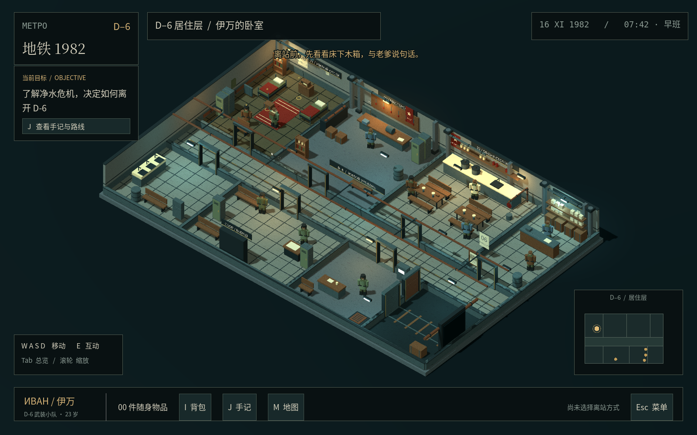

# 地铁1982 · D-6 居住层

可运行的 Godot 4 **3D 视觉与关卡原型**。范围到伊万离开 D-6 为止，后续章节没有定稿。模块化地下居住空间、原创低模角色、固定斜俯视正交相机、低分辨率材质和冷暖灯光；没有使用参考图做场景背景或直接贴图。

## 打开与运行

使用 **Godot 4.6.3 标准版**打开本目录的 `project.godot`，按 **F6/F5** 运行（主场景已设置）。无需 C#、插件、外部素材库或联网下载依赖。Compatibility 渲染器支持没有独立显卡的机器。首次打开等待材质、字体与声音导入。

Linux / 当前云环境：

```bash
cd /workspace/godot
./tools/run.sh
```

通过 `GODOT_BIN` 指定其他位置的 Godot。Linux 脚本会为配置、缓存、存档准备可写目录；普通桌面用户直接从编辑器运行也可以。当前云机器无物理显示器，图形运行需可用的 X11 显示；无显示时可执行下面的完整无界面回归，不能把无界面运行当作可交互画面。云端测试时另建了临时 Xorg dummy 显示进行真实 OpenGL 截图，未改动游戏的显示设置。

```bash
./tools/run.sh --test
```

## 操作

| 按键 | 功能 |
|---|---|
| WASD / 方向键 | 相对镜头的 8 方向移动，平滑转身与加减速 |
| E | 与最近且未被墙挡住的人 / 对象互动 |
| I / J / M | 背包 / 任务手记与情报 / 居住层平面图 |
| Tab / 鼠标滚轮 | 全层总览 / 调整镜头距离 |
| Esc | 关闭界面、取消等候或打开菜单 |
| F5 / F9 | 本地保存 / 读取（游戏窗口内） |

对话、背包、地图与菜单会停止玩家移动。金色标记只在附近显示；界面会明确说明缺少的道具或条件。背包道具在对应对话 / 调查选项中使用，避免无目的“对所有东西使用道具”。

## 试走一条路线

出生后调查床下木箱，带走匕首、烟和照片。先与谢苗诺夫谈话，再出门探索。**J** 中列出了所有路线的当前条件。登记征召不会马上结束探索，真正离站有二次确认和总结。

- **正式征召**：集合厅科瓦廖夫登记 → 第 7 供应点领取面具与滤毒罐 → 集合气闸。
- **劳动换许可**：妮娜借扳手 → 洗漱区断电柜取备用保险芯 → 东侧压力监测箱复位 → 回妮娜处领许可和防护 → 向伊戈尔出示 → 走正门到延伸线。
- **旧物交涉**：木箱取匕首 → 撬开箱底暗格取战前酒 → 与伊戈尔交换 → 走正门；酒被消耗，通行不记名。
- **换班侧门**：找米哈伊尔拿草图并用香烟换情报；或借扳手帮加琳娜止漏，领取热汤送给米哈伊尔。调查侧门选择准备，关闭界面后靠近侧门再次按 E 等黄灯，然后实际走过侧门。压缩为 **12 秒一轮、4 秒黄灯**，屏幕会显示倒计时；没有补发防护装备。
- **检修管线**：用扳手拆盖，保留工具；或用匕首硬撬，损失匕首。原型用调查结果与位置过渡表达钻管，不模拟完整爬行。抵达岗哨后方，再到延伸线确认离站。

不带防护也可确认非正式离站，界面会再次告知风险；原型不替后续章节判定生死。维生素可赠给米哈伊尔获得另一条许可提示；照片、收音机与粉笔标记提供可保留的父亲 / 东方-7疑问，而非直接揭晓答案。

## 内容与实现

7 位可对话人物、12 处调查 / 出入口、14 种可获取物品、5 类离站方式（其中情报和拆盖各有两种解法）。9 个空间区域含主通道。角色为原创、统一风格的低模占位资产，仍需后续正式人物美术替换；没有混用不匹配的外部素材。

| 文件 | 作用 |
|---|---|
| `scripts/world.gd` | 关卡布局、灯光、交互距离与视线、门、换班、相机、存档 |
| `scripts/kit.gd` | 米制模块、家具、管线、材质和静态 MultiMesh 批次 |
| `scripts/actor.gd` | 玩家 / NPC 外形、运动、实体碰撞与侧向让路 |
| `scripts/story.gd` | 对话、条件、物品、情报、序列化；不依赖场景布局 |
| `scripts/hud.gd` | 中文界面、背包、日志、地图、离站确认与记录 |
| `tests/run.gd` | 实际物理移动、任务路线、UI、存档回归 |
| `tools/make_textures.py` / `make_audio.py` | 原创纹理与声音生成器；运行游戏不需要 Python |
| `docs/DESIGN.md` | 基线取舍、比例、空间与扩展接口 |
| `docs/VALIDATION.md` | 验证方法、结果与已知限制 |

字体随项目提供：Noto CJK 子集（OFL）与 DejaVu Sans Mono，许可在 `assets/fonts/`。所有场景几何、纹理、UI、环境音与脚步音均为本原型生成，无需外部资源路径。

存档位于 Godot `user://d6_save.json`。Linux 启动脚本默认置于 `/workspace/.metro1982/data/godot/app_userdata/地铁1982 · D-6/`；通过编辑器运行时遵循操作系统用户数据目录。测试使用独立测试存档并在完成后删除，不覆盖玩家存档。

## 实机截图



[居室与工坊](docs/screenshots/residence.png) · [公共食堂](docs/screenshots/mess.png) · [对话界面](docs/screenshots/dialogue.png)
