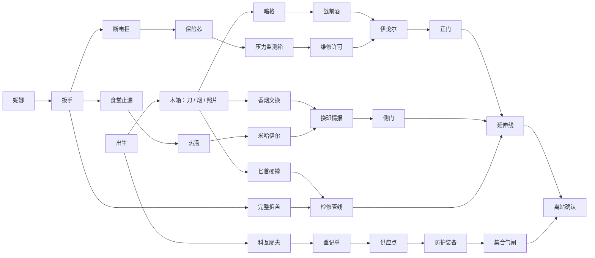

# D-6：本次切片的设计边界

本文记录 v1 初版设计。当前两层关卡、经济与图文序章见 [v5](CHAPTER-V5.md)。人物、完整墙体、动态遮挡与文案历史见 [v3 更新](VISUAL-V3.md)，卧室分室的历史变化见 [v2 视觉重构](VISUAL-V2.md)。

## 原版是基线，不是新版终稿

依据用户提供的 `1982.docx` 和 `地铁1982 v1.4.1.html` 中的 D-6 片段：1962 年战争、二十年后地下生活、净水设施失效与两周储水、伊万受征召、谢苗诺夫抚养、米哈伊尔的维修草图、老伊戈尔把守东侧、战前伏特加、卧室旧物与东方-7。文档标题中的“完整 / 最终”不作为开发约束。上传 HTML 的标题、文件名与内部版本标记不一致，本次按故事内容取材，不把版本号当成新版剧本承诺。

明确保留：净水滤芯和面具滤毒罐是不同东西；普通人与全苏中央的资源差距；人与人的交换；原有的父亲与星轨线索。谢苗诺夫是否识字在两份来源中矛盾，本次不强化这个细节。

局部新增：维修工妮娜、厨房负责人加琳娜、配给员柳德米拉；止漏换汤、恢复压力监测换许可、维生素的人情用途。原来的“酒后睡着，偷走武器”在这次原型里改成有代价的私下放行和备用防护交换；未做战斗、持枪系统或醉酒模拟。角色关系不是最终写死的分支树。

不制作：地表、水厂关卡、公社、谢契、星城-2、父亲生还揭晓、90 分钟全剧本、后续结局、潜行 AI、战斗和武器。这些只通过离站携带状态和情报留接口。

## 空间和尺度

世界坐标 XZ 为地面，Y 为高度，单位为米。约 30 × 19m 的可用层面。7 个生活 / 工作区域、东段延伸线和 3.2m 主通道。整体使用新的功能分区，未复制参考图布局。

| 元素 | 尺度 |
|---|---|
| 伊万 | 无帽头顶约 1.75m；碰撞胶囊高 1.72m、半径 0.26m |
| NPC | 相同人体基准，胶囊半径 0.23m；衣帽轮廓稍大 |
| 普通门 | 可通行宽约 1.45m，开口高约 2.06m |
| 主通道 | 宽 3.2m；管线在 2.9m，位于人物头顶以上 |
| 桌面 | 高 0.75m；实心统一脚印，不能钻进腿缝或走上桌面 |
| 床面 | 约 0.56m（床垫上表面）；家具脚印与床垫一体阻挡 |
| 长椅 | 坐面高 0.51m，座下统一碰撞，椅脚不另设小障碍 |
| 完整墙 | 2.8m 实体阻挡；镜头前采用约 0.6m 切墙表达，碰撞仍完整 |

普通房间动线留在家具组合外围；大食堂通过两张长桌形成中部与侧边通路。NPC 位于功能区而非门洞中央，且能主动侧向让路。洗漱区与工坊位于主通道两侧，维修准备必须经过生活空间，形成短距离折返，而不是多个互不相干的按钮房间。

本版是共居房间尺度验证，未机械保持原文“三平米”房间的面积。后续可拆成个人睡眠龛与公共起居区；目前不缩小门宽和人体以迁就原文面积。

## 视觉语言

- 正交相机固定方位（位置差 23 / 30 / 27），只跟随、缩放与总览，不任意旋转。
- 真实 3D 可行走几何；后墙、支柱、金属护墙、门框与管线提供深度。近墙切除为阅读服务。
- 灰绿混凝土、氧化铁、木家具、米黄色纸、深红织物。128×128 原创材质纹理，Nearest 过滤，仅保留轻微颗粒；屏幕与中文 UI 保持正常分辨率。
- 暖色居室与食堂、偏冷供应点 / 洗漱区 / 东段，辅以柔和方向光，暗处保持轮廓。
- 原创低模角色用圆柱、椭球、衣服层次、口袋和装备建立人体形态，并带步行动画；未使用网格方块人物或整图背景。
- 只有邻近物体显示小标记，只有最近可达目标显示名称与 E 提示。任务详情集中进 J，降低日常探索的文本覆盖。
- 静态模块按材质、几何类型和空间格进行 MultiMesh 批次；动态门、NPC、交互标记保持独立。

## 任务网络

道具获得与消耗在 `Story.act` 再次校验，不能通过重复点击刷物品。界面显示未满足条件，不把不可选分支完全藏掉。接任务不是修理的硬门槛，观察到问题并拥有正确工具也能完成，避免“先接任务才能让设备坏掉”的逻辑。

侧门是实际物理开口：知道情报后，需等黄灯并走过去。穿过后保持开启，避免关门夹住玩家或无法回头。检修管线只做短过渡到门后，未伪称为完整爬行控制器。正式登记不锁死其他路线；确认离站前随时可回头。

## 后续接口

`Story.serialize()` 输出 version / flags / items / intel / route / ending。后续章可读取离站方式、防护、人情和父亲线索。将对白继续拆成外部资源、补人物关系值、按区块替换模型，都不要求重写移动或碰撞。

本次没有发布游戏、修改 GitHub 远程分支或提交源文件到远程；交付物保存在当前工作区。
