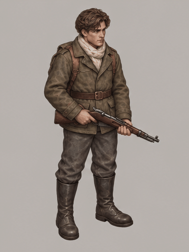
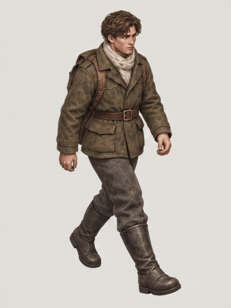
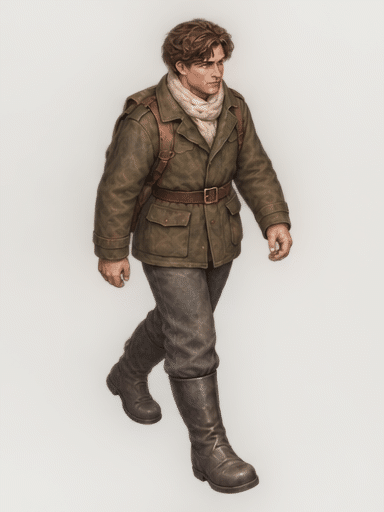

# 伊万动作 GIF 样片 · 2026-11-16

本次使用当初最初裁出的伊万右前站姿，形象源头为 V3 提交 057fff3。每次生成都直接参考这张原站姿，没有把本轮生成结果反复用作形象参考。

**型号说明：当前 image_gen 接口未暴露模型名称或型号选择，无法确认后台是否为 image2.6。这里是 AI 生成静态动作图集，再本地编码 GIF 的测试，不能据此宣称验证了 image2.6 原生动图能力。**

## 举枪、瞄准、射击、收回

[原始八帧图集](gun-sheet.png)。八帧的动作顺序可辨；射击帧有小幅枪口闪光。头部、脚点和枪形仍有轻微变化，尚未通过游戏资产验收。这里只验证固定视角、原地上半身动作，不表示持枪走路已经完成。

## 步行：第二次尝试

[原始八帧图集](walk-retry-sheet.png)。仍存在同侧腿反复领先、两次相反落脚不清楚，以及上身轮廓漂移。这份稿不合格，不会替换已认可的游戏动作。它说明把八张画面拼成 GIF，并不会自动解决连续动作逻辑。

查看第一稿，保留测试过程

第一稿有重复姿势，且请求透明背景后仍有非零背景 alpha，因此不作为透明游戏图集使用。

## 查看与下载

- 直接点击 GIF 可单独查看／下载。
- [离线预览包](ivan-motion-gif-pilot.zip)：解压后打开 preview.html，可暂停、逐帧、调整速度，与原站姿比较。无需联网或安装软件。
- [原始参考图](original-reference.png)、[完整提示词](prompts.json)、[帧数与时长验证](verification.json)。

共调用三次生图：两次步行，一次枪械动作。图集按等大格子裁帧，保留原始位置与绘制差异；未剪贴腿、镜像、拉伸身体或用插帧算法假造动作。GIF 每段共用一个调色板，避免逐帧量化额外闪烁，但不能消除原画本身的色差。GIF 使用不透明背景进行预览，不作为最终透明游戏素材。当前只做右前一个视角，游戏工程及四套认可图集未修改。
