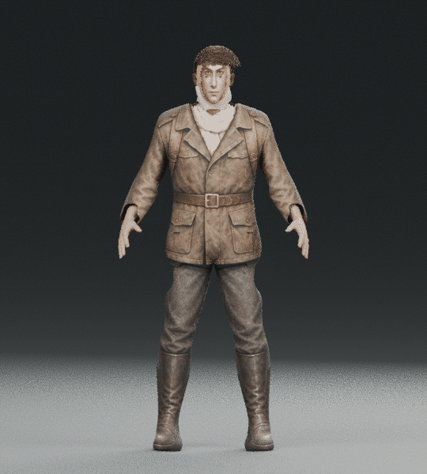
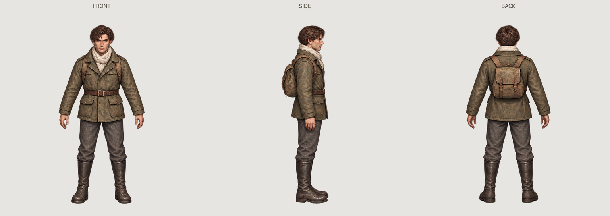

# 伊万 · Blender 外形试作 01

**这是在云端 Blender 4.3.2 中制作、实际渲染的独立三维样模。** 不需要在你的电脑部署 AI 模型。当前只验收外形与材质，没有替换游戏人物，没有制作正式步行或战斗动画。

## 在线看效果

[四视图大图](four-views.jpg) · [实际俯视镜头](renders/game.png) · [正面](renders/front.png) · [侧面](renders/side.png) · [背面](renders/back.png)

转台是摄像机围绕静态模型转动，非 AI 生成的假转台，也不是走路动画。

## 建模依据

以此前的 **B 稿正、侧、背三视图**为衣服、配色和形象依据。参考图嵌入 Blender 工程并作为可开关的正交辅助图，投影贴图也来自这三张图。

几何结构采用 MPFB/MakeHuman 的 CC0 人形基础网格，调整为正常成人比例，保留真实五官、手指与关节拓扑；再制作夹克、裤子、靴子、围巾、皮带、背包与短发。它不是直接由三张图自动重建的 AI 网格。

## 下载

- [下载独立样模包 ZIP](ivan-B-blender-study.zip?raw=true)
- [直接下载 .blend](ivan-B-study.blend?raw=true)

`.blend` 已打包四张外部图像，包括眼睛贴图和三张 B 稿参考；打开和查看不要求安装 MakeHuman 插件。原始人体与辅助网格不参与渲染，参考图默认隐藏，可在集合中开启。文件使用 Blender 4.3.2 保存。

## 已检查

- 在未启用 MakeHuman 插件的新 Blender 进程中重新打开工程。
- 所有外部图像已嵌入，无缺失贴图。
- 基础骨架有 53 根骨骼；小幅转动上臂时，手部与夹克网格实际发生相应形变，保存前已恢复站姿。
- 正面、侧面、背面与俯视镜头均实际渲染。

[文件与骨架检查结果](verification.json) · [样模数据](study-report.json) · [参考来源与素材许可](source/reference-provenance.json)

## 仍需细化

这版用于判断三维路线和外形：头发的形似、侧面投影与部分衣服接缝仍需继续细化，当前约 16 万个基础顶点，尚未为多人场景做 LOD 优化。部分服装细节来自投影贴图，不能把所有画面细节都视为已制作成立体雕刻。

有基础骨架不等于已经完成动作。走路、持枪、移动换弹、防毒面具和战斗动作都还没有制作或验证；本包也没有声称提供这些功能。先确认外形，再继续动作和游戏导出。

构建脚本保留于 source，作为可审阅的制作过程记录；其数据路径指向本次云端工作区，不是用户安装器。
