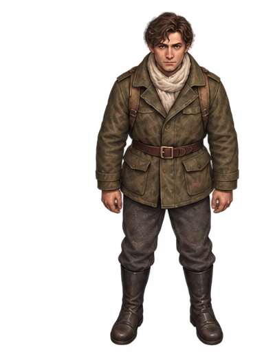
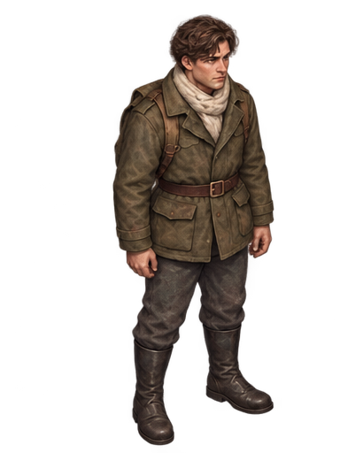
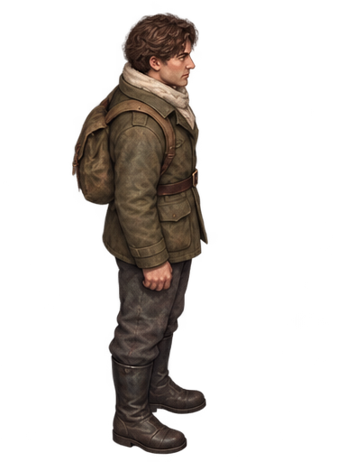
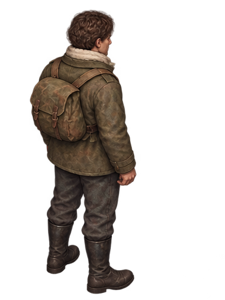
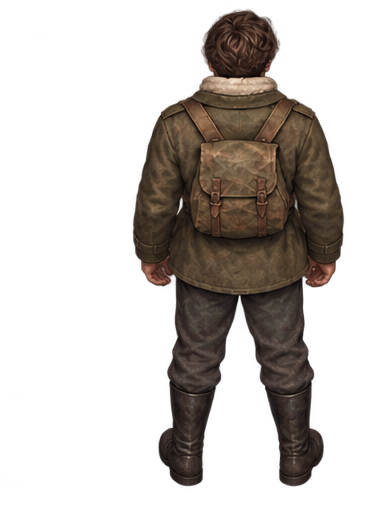
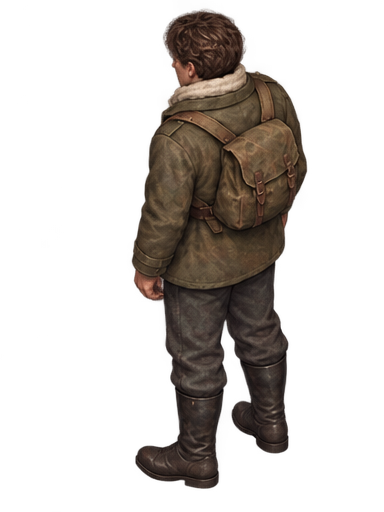
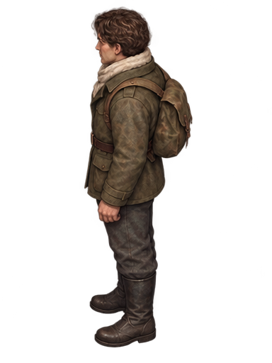
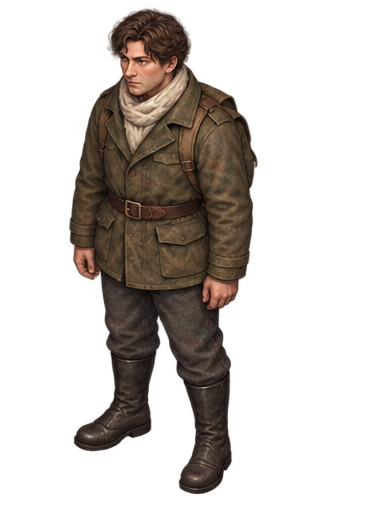

# 伊万八方向独立站姿参考图

从用户认可的八方向站姿原图，按四列两行无损裁切。每张 384×512 像素；保留原始像素、背景、比例和人物在各自单元中的位置，没有重绘、锐化、拉伸或镜像。原图人物约高 470 像素，拆分不会增加原始细节。

用于后续生成时，每个朝向分别引用对应站姿图。迈步 A、B 都直接参考这张站姿，避免连续参考导致外观漂移。明确描述画面中的近侧/远侧腿和鞋子前后位置，固定头身比例、肩宽、骨盆位置和镜头角度。

生成后仍需逐张检查，单张参考不能保证比例与位置完全不变。只允许整个人物的等比缩放与平移来登记画布，不能单独拉伸头、躯干或腿部。步行需要自然轻微重心起伏，不应强制每个身体像素完全不动。

这份资料仅包含站姿切图，没有生成新的迈步帧，也没有修改游戏或接入独立验证项目。

## 正面

## 右前方

## 右侧面

## 右后方

## 背面

## 左后方

## 左侧面

## 左前方

