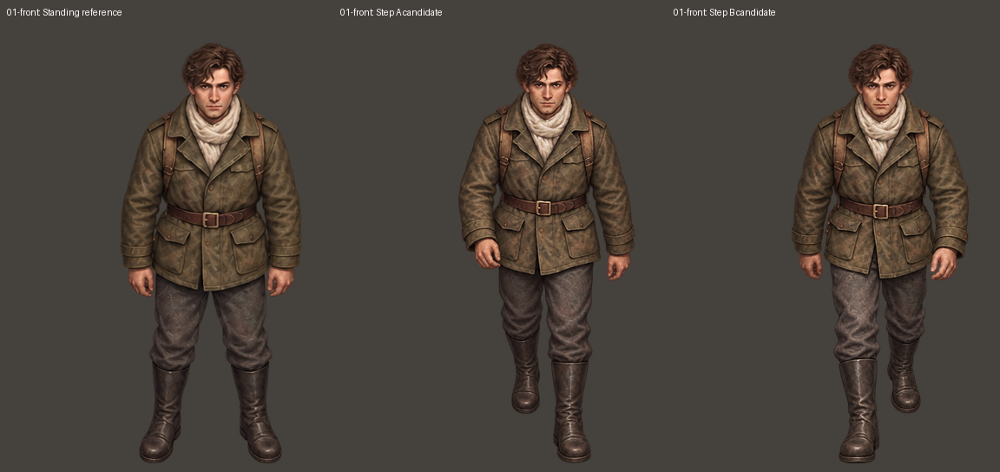
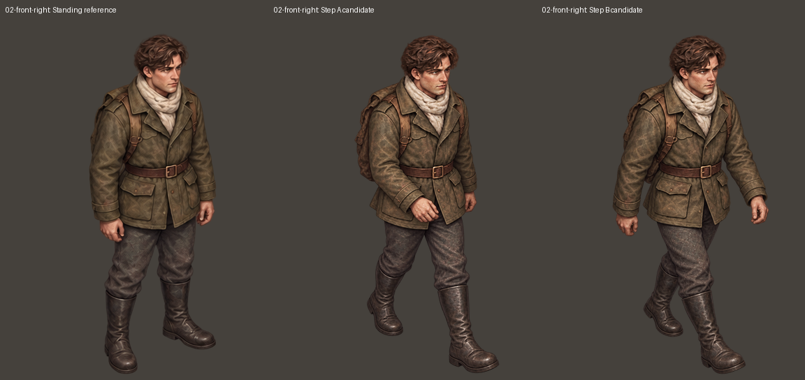
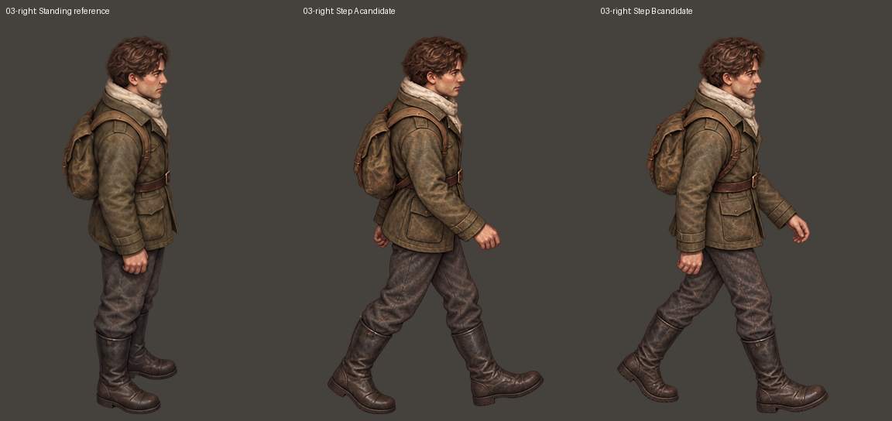
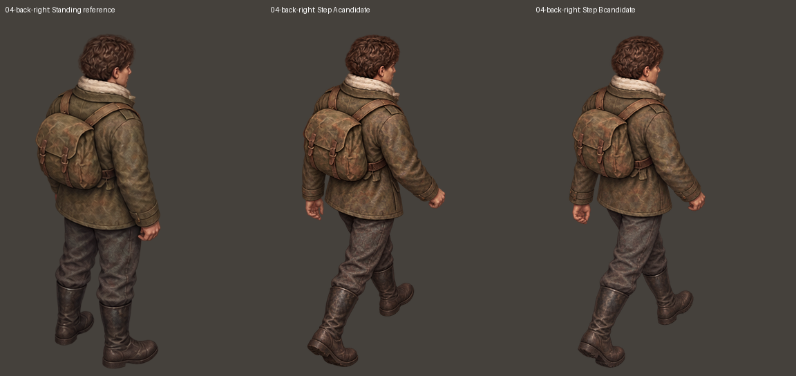
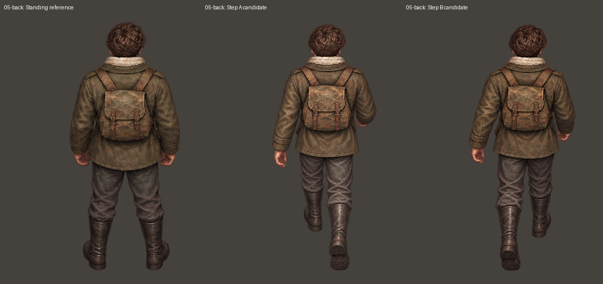
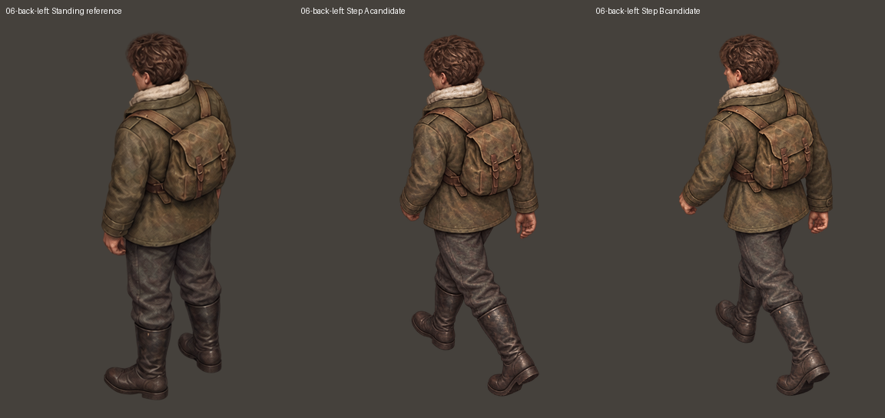
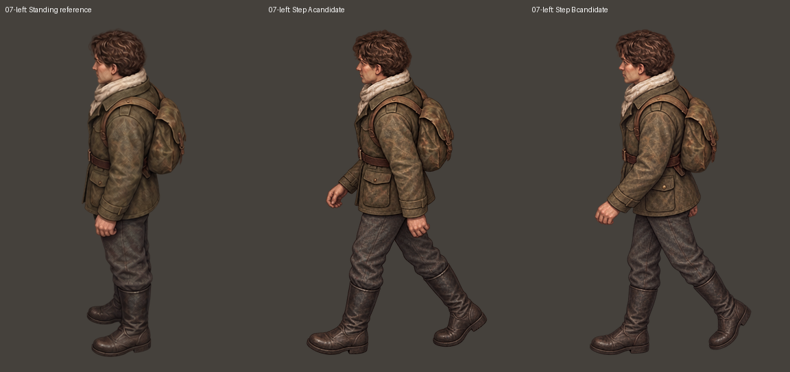
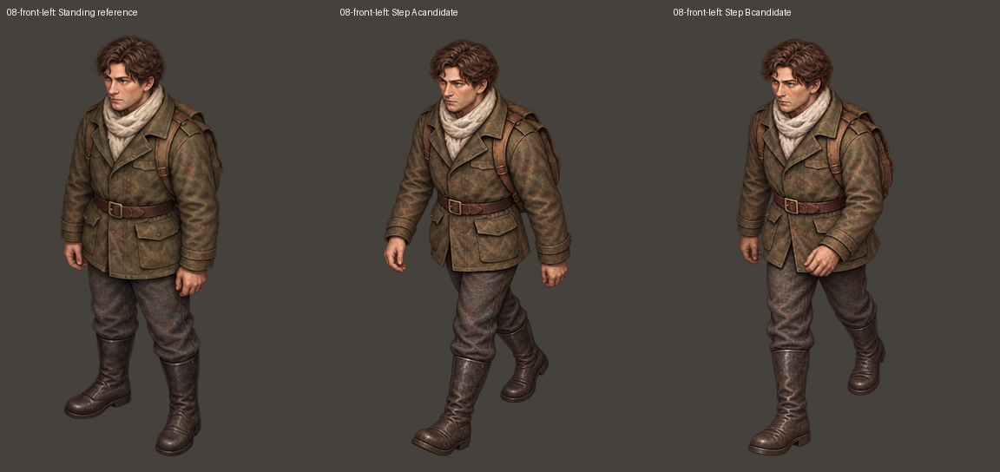

# 伊万：八方向独立参考生成的 16 张迈步候选图

每个朝向以用户认可的对应站姿为形象参考，分别生成 A、B。没有修改游戏本体，也没有接入独立演示项目。

## 审阅结论

16 张图片已生成，但不能把“生成完成”等同于“动作合格”。右后方（04）和左后方（06）多次重画后，A/B 的近侧腿前后交换仍不够明确，暂不合格。其他方向可对照检查，但体宽、头部、衣服细节与步幅的一致性仍需审阅，尚未验证成流畅动画。A/B 是候选文件名，不代表所有方向都已经正确完成解剖学左右腿交替。

最初 16 次生成均只引用对应站姿；其中 02-A、05-A、08-B 的选用修正版还引用了相反动作候选作步态对照，形象仍以原站姿为准。04-B、06-A 最后修正版重新只引用对应站姿，依然未解决换腿问题。没有用镜像或剪切身体部位冒充换腿。

## 文件

- raw：选用的 16 张 AI 生成原图，保留原始清晰度。
- aligned：384×512 透明画布审阅版；仅对完整人物等比缩放、平移，按对应站姿的整体高度、头部横向中心及头顶位置对齐。不局部变形、不修补人体。这只统一外部尺度，不能修复内部比例偏差，也不代表完成了动画脚底接触校准。
- comparison：每个方向一张“站姿 / A / B”并排图。
- manifest.json：来源路径、原始尺寸、等比缩放和平移记录及待审状态。

[下载 16 张原图、统一画布版与对照图](ivan-individual-steps-01.zip)

## 01-front

[原图 A](raw/01-front-A.png) · [原图 B](raw/01-front-B.png)

## 02-front-right

[原图 A](raw/02-front-right-A.png) · [原图 B](raw/02-front-right-B.png)

## 03-right

[原图 A](raw/03-right-A.png) · [原图 B](raw/03-right-B.png)

## 04-back-right

[原图 A](raw/04-back-right-A.png) · [原图 B](raw/04-back-right-B.png)

## 05-back

[原图 A](raw/05-back-A.png) · [原图 B](raw/05-back-B.png)

## 06-back-left

[原图 A](raw/06-back-left-A.png) · [原图 B](raw/06-back-left-B.png)

## 07-left

[原图 A](raw/07-left-A.png) · [原图 B](raw/07-left-B.png)

## 08-front-left

[原图 A](raw/08-front-left-A.png) · [原图 B](raw/08-front-left-B.png)

