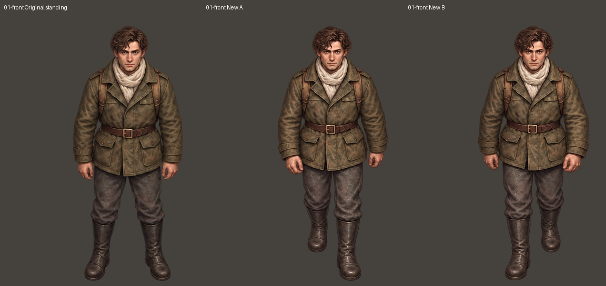
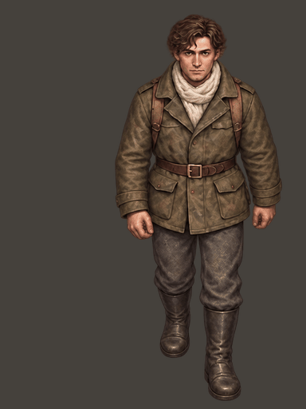
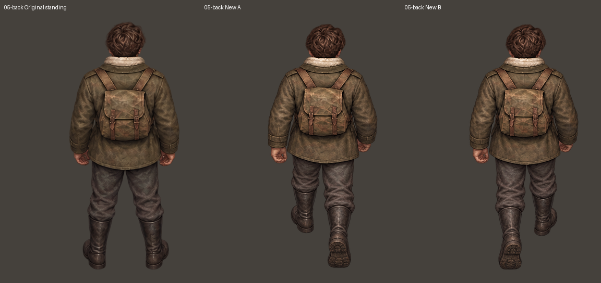

# 伊万正面 / 背面稳定性修订候选

本轮选用正面、背面各一张双帧生成稿，共四帧。所有人物形象参考均来自最初裁出的站姿，没有引用上一轮生成的人物作为形象参考。原图为 raw；从每张原图等分为两帧，统一到 384×512。

同一方向两帧使用同一个整体缩放系数，以原站姿头顶和头部横向中心登记位置，避免按每帧脚底范围分别缩放导致人物大小变化。没有拉伸或拼接身体部位。正面原生成图的左右帧顺序与原 A/B 约定相反，切图时仅调换两张完整画稿的文件顺序，没有镜像人物。

## 当前结果

正面和背面在这组双帧稿中的体宽与上身差异减少，尚需结合原站姿审阅与实际动画验证，不宣称完全解决。左右后斜方向本轮仍未获得可靠的相反迈腿稿，暂不更新：双帧生成、姿态示意图辅助以及单帧重绘尝试仍未通过。其他四个方向沿用上一轮，不重新生成。游戏和独立演示项目均未改动。

## 后续装备制作建议（本轮没有生成）

1. 基础 24 帧通过后，固定为不可覆盖的母版。
2. 面具优先制作八方向装备覆盖层，保留原脸部之外的头发、身体与腿部像素，适配各步态锚点。需要按脸部、头带和头发前后遮挡检查。
3. 持枪主要改上身、手臂与武器，腿部和迈步周期沿用母版；按方向分小组生成，检查旧手臂是否清除干净、握把和枪托是否贴合。不能只是把枪粘到原来垂下的手上。
4. 面具持枪复用已验收的面具层与持枪上身，避免把整个人物再重绘一遍。需要测试遮挡关系后才能组合。
5. 先用一个斜方向验证分层方案，再扩展；失败时才补做特定方向，不承诺固定生图次数或消耗额度。

## 01-front

## 05-back

