# 伊万基础动作第三轮整理 + 单方向面具分层样片

本轮补修了右后方、左后方各两张迈步图。四张新画稿均只以最初裁出的对应站姿作为人物外观参考；附加的灰色体块图仅约束髋部—膝盖—脚踝的连接与前后关系，不是伊万的建模方案，也没有用于改人物画风。没有将上一轮生成的人物反复用作形象参考。

## 当前状态

左右后斜方向的近侧腿现在能区分前伸与后蹬，已不再选用原来的重复姿态。上衣和背包的一致性也比旧的另一迈步帧更接近。文件仍是待审阅候选，不宣称已经完全定稿或完成游戏内动画验收；各帧的服装细节和轻微上身差异仍可通过下方循环图检查。

正面和背面沿用上一轮四张稳定性修订稿，其他四方向沿用原候选图，八张站姿保持原始像素不变。steps 中共 16 张迈步，standing 中共 8 张站姿，均为 384×512 画布。同一后斜方向两帧采用同一个整体等比缩放系数，再以原站姿头顶与头部横向中心登记位置，没有镜像角色、拼接腿部或局部拉伸身体。

游戏本体与独立演示项目未修改；这份包用于先审阅图片。

## 分层装备首个验证

[右前方向面具样片、循环图和像素验证](equipment-pilot/README.md)：只生成一张面具覆盖层，在站姿和两个迈步之间复用，面具覆盖范围之外的像素完全不变。

持枪版和面具持枪版尚未批量生成。计划固定验收后的基础动作，单独制作持枪上身，再复用面具层；原有手臂的清除、握枪姿态、头发/头带/枪身的前后遮挡仍需实际验证，不能将当前面具样片当作枪械分层已完成。

[下载全部 24 张基础图、对照图、循环动画和面具样片](ivan-base-motion-03.zip)

## 01-front

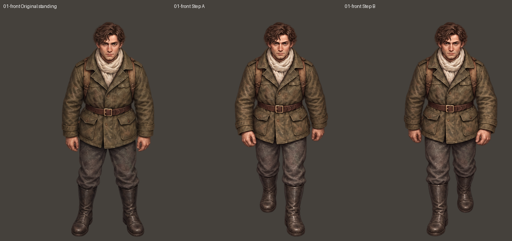

## 02-front-right

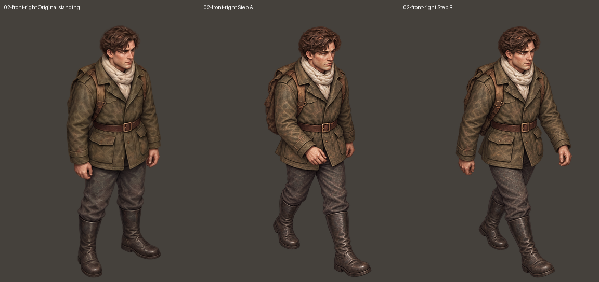

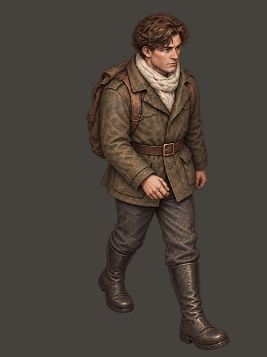

## 03-right

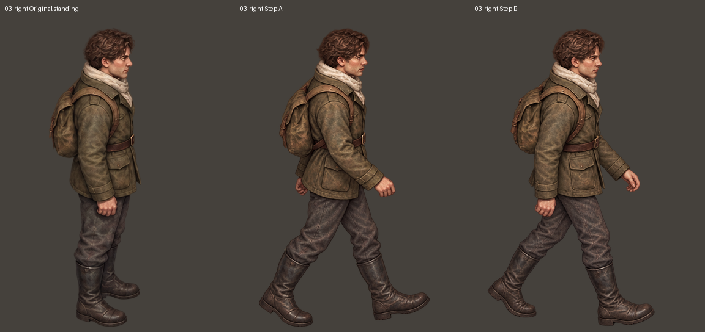

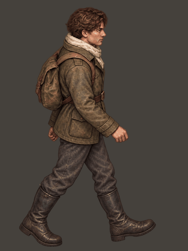

## 04-back-right

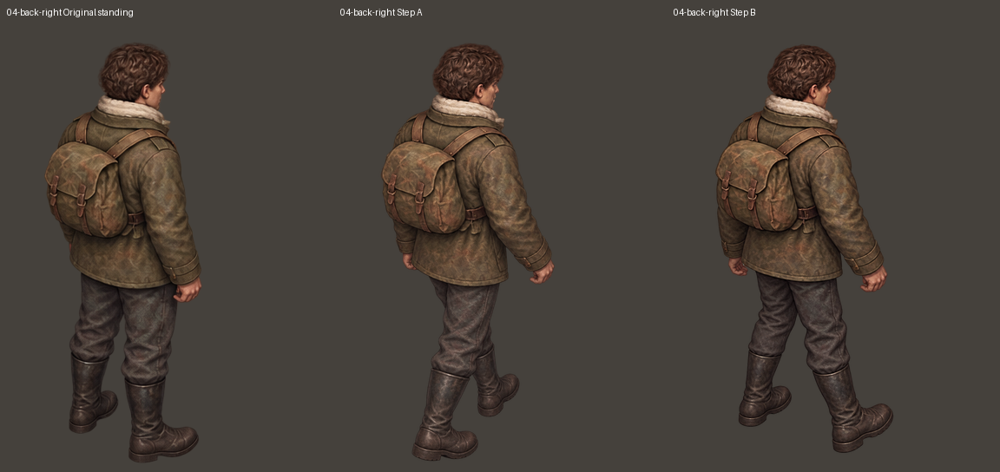

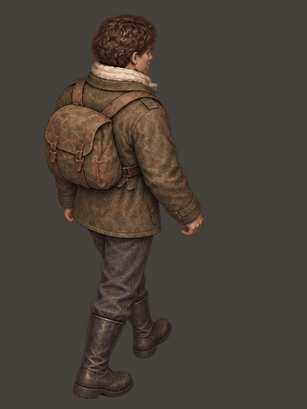

## 05-back

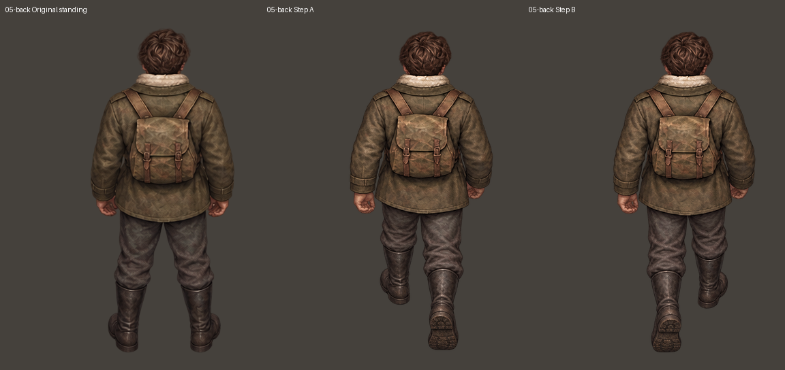

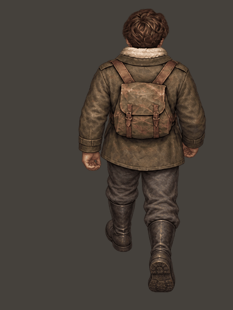

## 06-back-left

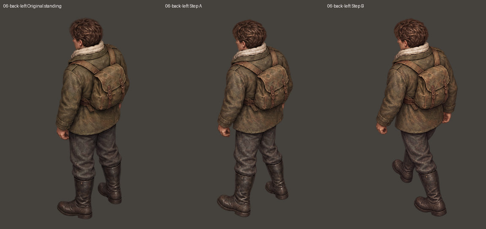

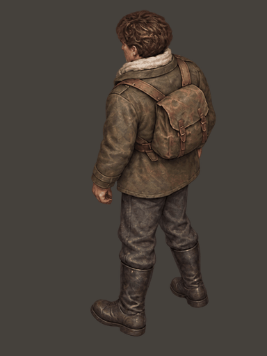

## 07-left

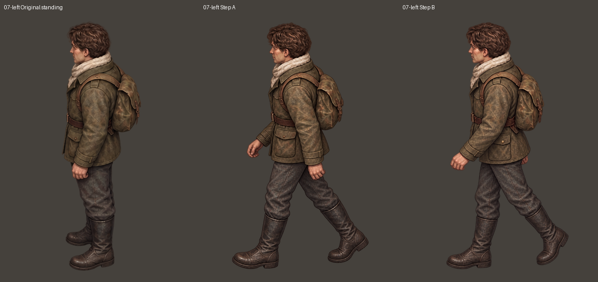

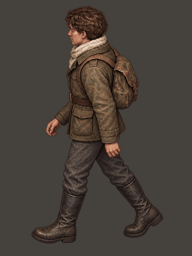

## 08-front-left

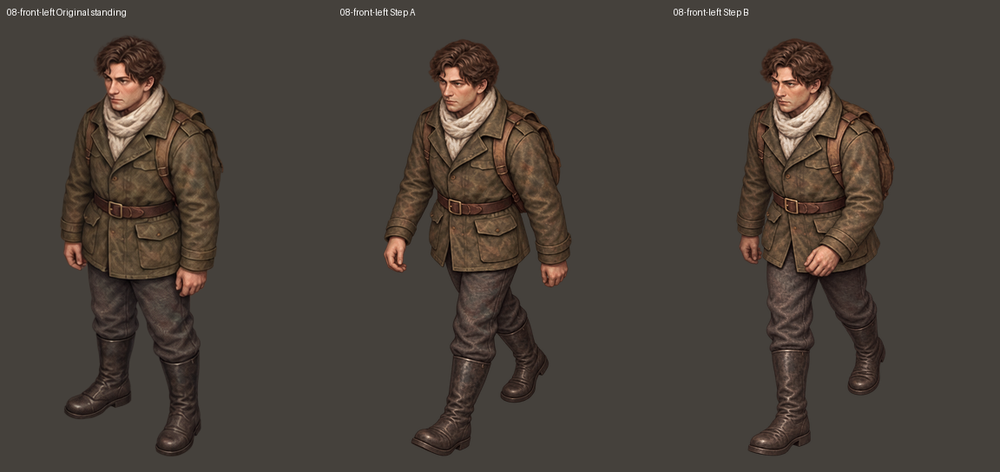

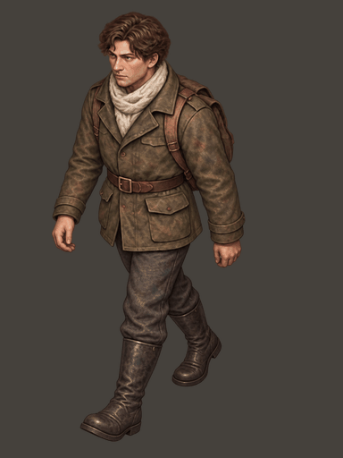

