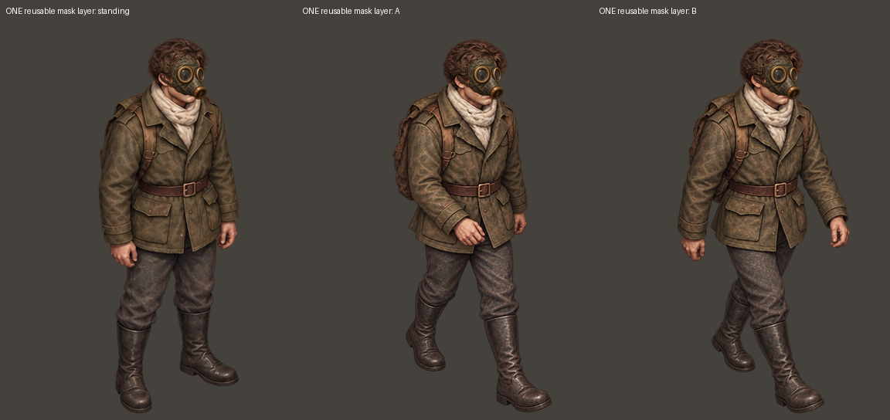
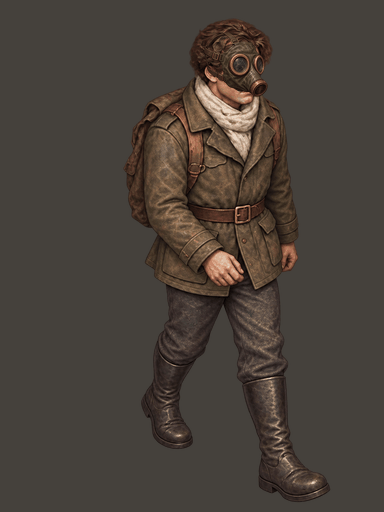

# 右前方向面具分层验证

仅生成一张面具覆盖层，然后将同一素材复用到站姿、迈步 A、迈步 B。人物形象参考为最初裁出的右前站姿，面具外观参考游戏现有 item_mask.png，没有拿上一轮生成的人物作为形象参考。

mask-overlay-source.png 是 AI 原图；mask-layer-front-right.png 是等比缩小和平移到头部位置后的透明覆盖层。三张 front-right-mask 图片为该层与各自母版的标准透明叠加，未修改母版。

verification.json 记录三帧覆盖区域外像素完全相同，画布 y≥128 的身体与腿部像素完全相同。此验证证明分层没有改动这些像素，不代表所有朝向和装备的遮挡均已解决。

当前仍是审阅样片。正式扩展需要逐方向检查面具边缘、头带、头发遮挡与行走时贴合。持枪上身层尚未生成：它还需要正确替换原来垂下的手臂、调整握枪姿势与遮挡，不能只贴一把枪。

