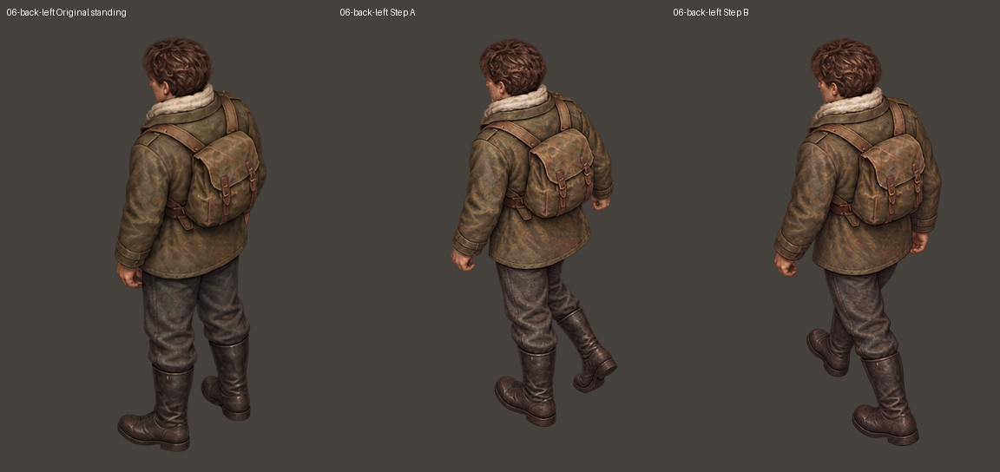
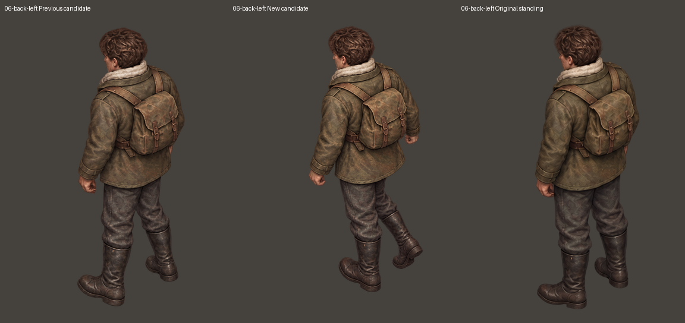
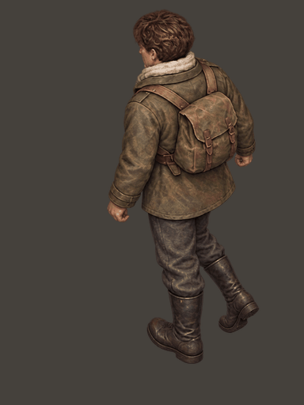
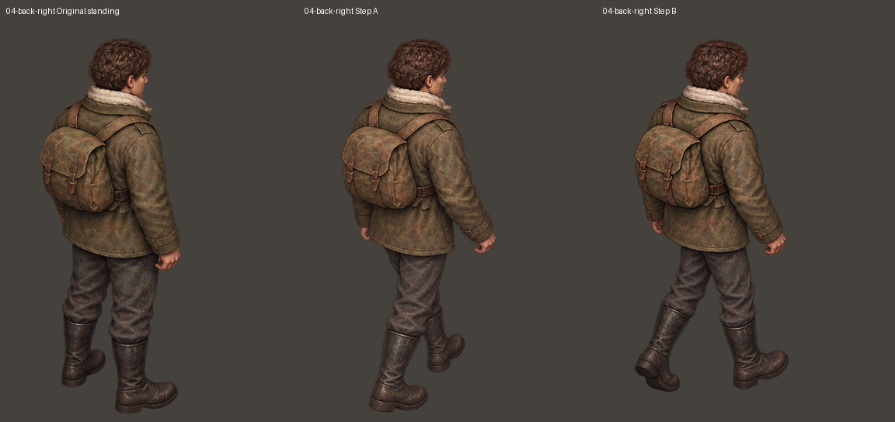
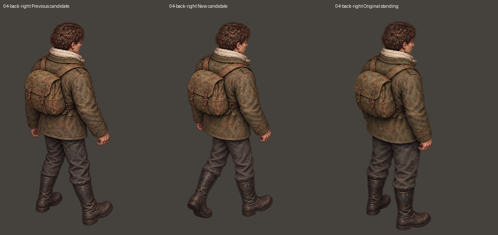
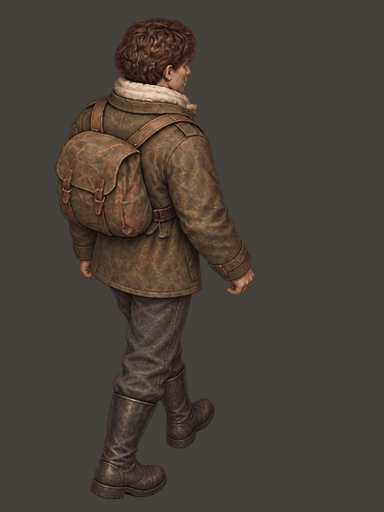

# 只修左后迈左腿、右后迈右腿

本轮只更新 06-back-left-A.png 与 04-back-right-B.png。人物形象仍取自最初裁出的对应站姿，辅助体块图只约束腿部姿态；没有拿上一轮生成的人物反复做形象参考。新图着重调整前腿膝盖、落脚以及后脚脚跟抬起/脚尖蹬地。

其他 22 张基础图逐文件字节相同，SHA256 记录见 verification.json。新增帧沿用对应方向上一版的整体缩放系数，以原站姿头顶和头部横向中心对齐，不局部拉伸身体、不拼接腿部。

这是新候选稿，等待用户审阅，不宣称动作已经最终验收。游戏本体与独立演示项目未改动，本轮没有生成或修改装备版。

- steps：完整 16 张迈步；其中仅上述两张更新。
- standing：原始 8 张站姿，未修改。
- comparison：站姿、A、B 三图对照。
- before-after：上一版与新候选对照。
- loops：A—站姿—B—站姿循环。
- raw-changes：仅两张新稿的原始清晰度文件。

[下载完整 24 张基础图和本轮对照](ivan-rear-contact-patch-04.zip)

## 06-back-left

## 04-back-right

