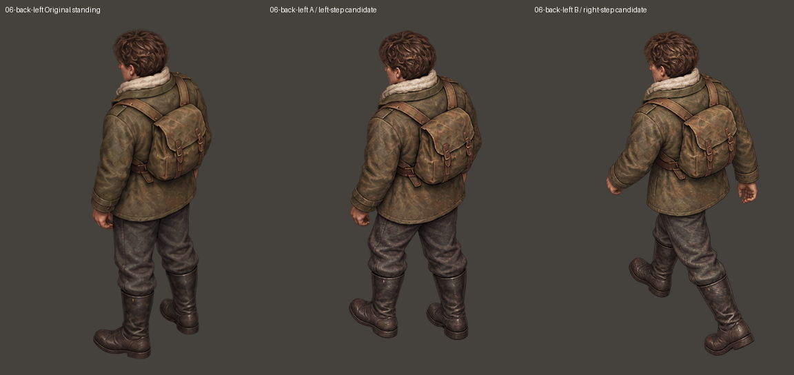
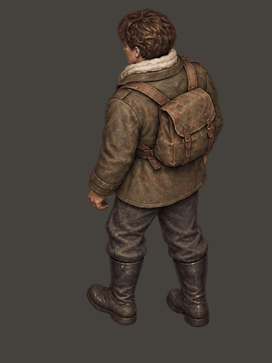
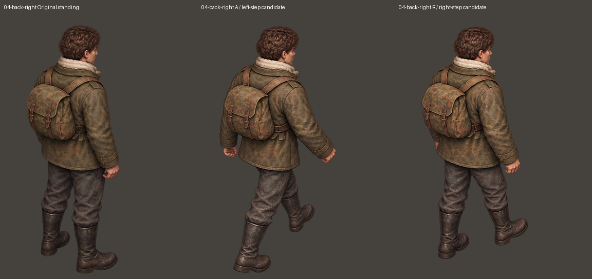
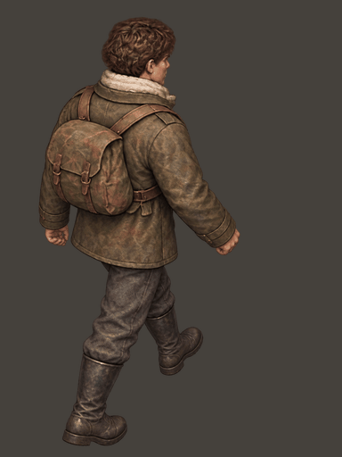

# 后斜方向：仅原始站姿参考的四张新候选

本轮按用户指定的方法：左后方两张都只引用最初裁出的 06-back-left.png；右后方两张都只引用最初裁出的 04-back-right.png。每次独立生成一张，不引用另一张动作稿、不添加姿态辅助图、不使用生成图反复投喂。provenance.json 记录每张选用稿唯一的参考路径。

首轮四张中，两组都有相近步态，不能直接算合格。左后 A、右后 B 又分别以同一原站姿做了一次更小范围的腿部编辑。最终选用四张新候选，仍需检查迈腿是否自然、两腿粗细、两步幅度和上身稳定性，不宣称已经定稿。文件中的 A/B 表示期望的左脚/右脚阶段，不能仅凭文件名判定动作已正确完成。

只有两组后斜方向的四帧被更新；其余 20 张基础图逐文件字节相同，校验记录在 provenance.json。原八张站姿未改。raw 是生成原图；steps 是 384×512 审阅版，同方向采用共同的整体等比缩放，并对齐原站姿头顶及头部横向中心，没有局部拉伸、镜像或拼接身体。

游戏本体与独立演示项目未修改，本轮没有扩展装备版。

[下载全部 24 张基础图、四张原图与循环对照](ivan-original-only-rear-05.zip)

## 06-back-left

[原图 A](raw/06-back-left-A.png) · [原图 B](raw/06-back-left-B.png)

## 04-back-right

[原图 A](raw/04-back-right-A.png) · [原图 B](raw/04-back-right-B.png)

