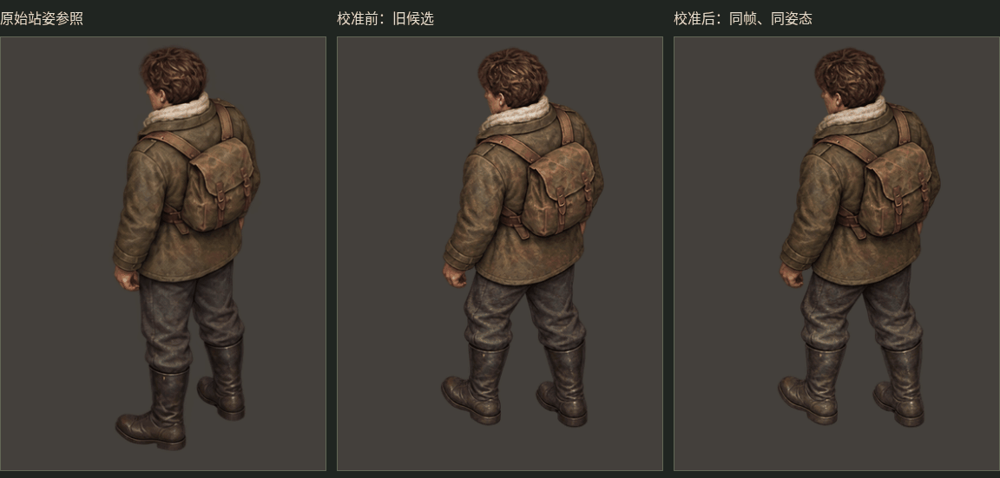
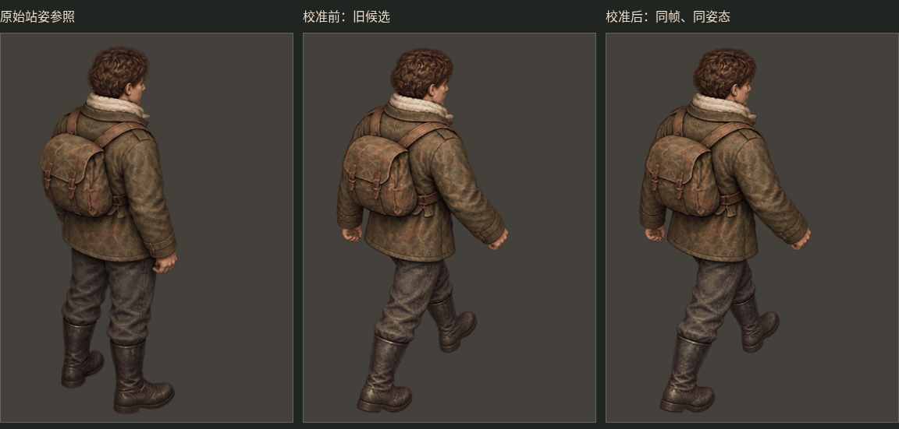

# 色调校准验证：步态仍未完成

用户指出的两个问题成立：上一批将小步重试稿与大步初稿配成一组，步幅不一致；独立生成的曝光、色调和纹理也不一致。上一批没有通过动画验收，不应把输出了候选图当作修复完成。

## 本轮结果

- 仍以最初站姿为唯一形象参考，尝试同一次生成中的双帧配对，但两组依旧重复迈出同一条腿。两张失败的双帧图均未作为更新素材交付，也未继续生成装备。步幅与正确换腿 **仍未解决**。
- 单独完成了可运行的色调校准预览，用上一批旧候选作为输入，避免把颜色改善与步态改善混为一谈。原 PNG 未改，游戏与独立演示项目未改。
- 在浏览器渲染时按每帧衣服/裤子采样区域，施加线性 RGB 增益，区域之间平滑过渡。没有改变图形坐标、alpha、腿长、步幅或帧时长。

## 查看

下面两张 GIF 的三栏依次为：原始站姿参照、旧候选原色、同一帧的校准效果。使用共同 GIF 调色板，避免逐帧调色板额外引入色差。

[下载离线交互预览 ZIP](ivan-color-calibration-preview.zip)。解压后用浏览器打开 preview.html，可切换方向、暂停、逐帧和调整播放速度。HTML 自带图片，不需要服务端或联网。GitHub 网页只展示文件源码，不能在文件预览页运行交互。

## 验证与实际限制

浏览器实际运行验证了两方向各三帧共六个状态、两栏同步、逐帧控制以及透明轮廓不变。用未参与校准计算的另一块衣服区域测量，四张动作图相对原站姿的平均线性 RGB 色彩偏差下降约 33%—46%。采样区域与原始结果见 browser-verification.json、measurements.json；这不是对整个人物闪烁程度的测量，也不代表颜色完全相同。

这套处理只能减轻曝光与色调跳变，不能消除不同纹理、阴影形状和身体轮廓造成的跳动，更不能修复步幅。当前仍不应接入游戏作为合格动画。
