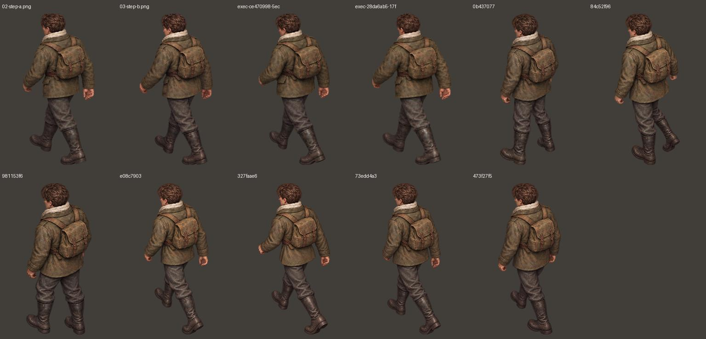
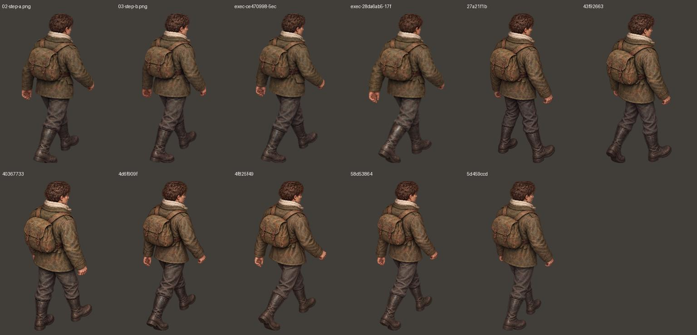
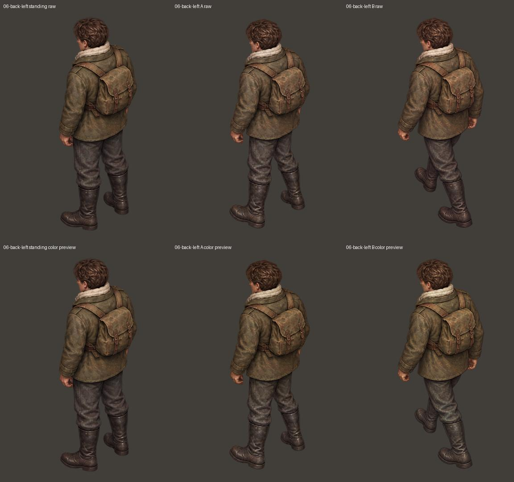
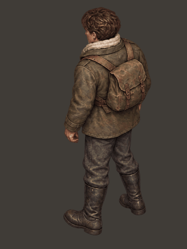
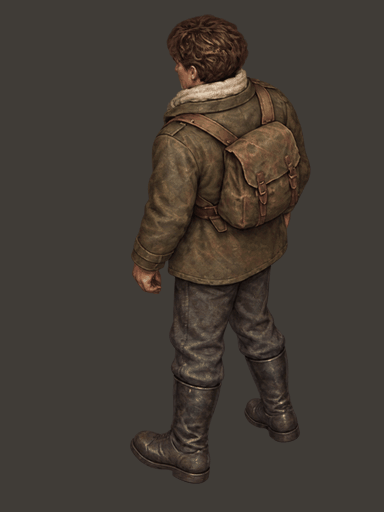
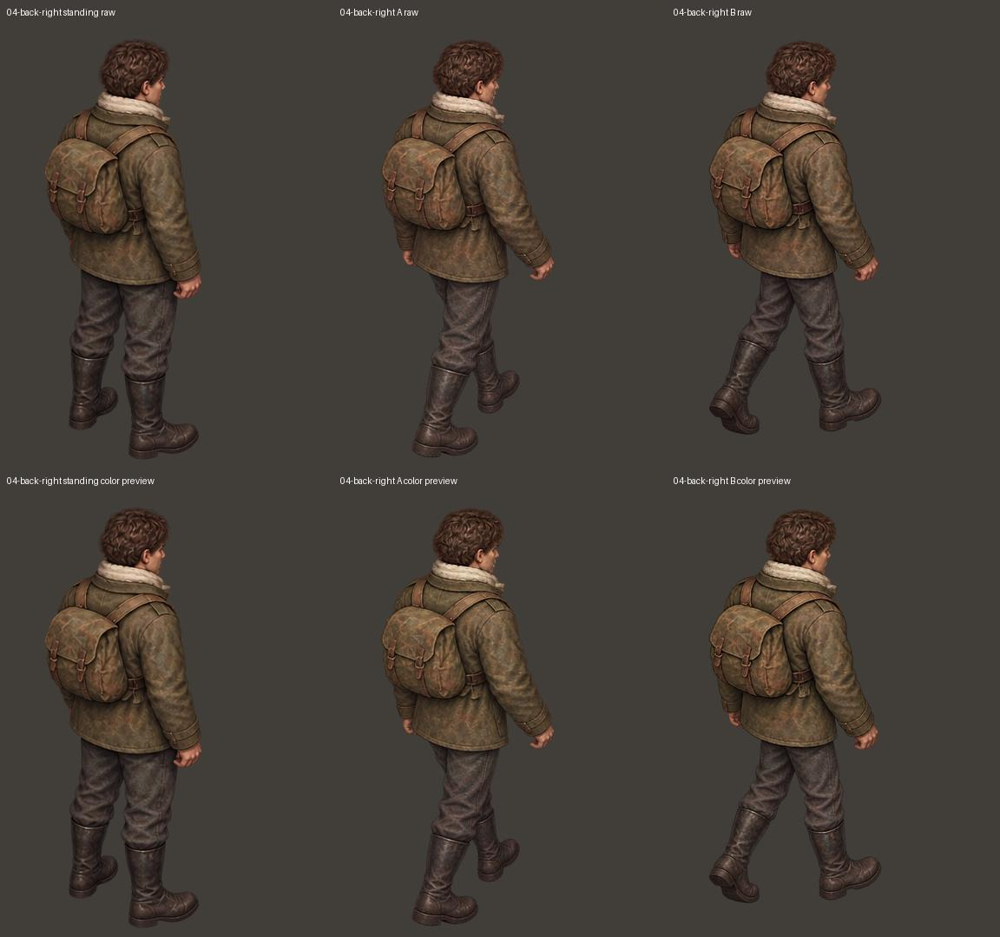
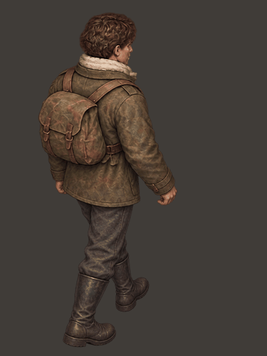
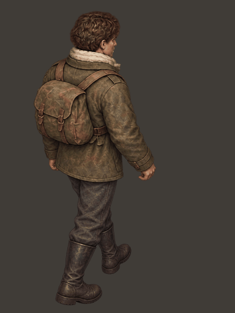

# 历史迈步稿筛选与调色对照

本次没有生成新图片，没有修改游戏。检查了最早的八方向迈步整图及后续单张稿；只用已有候选做对比，不将其标记为完成版。

## 结果

早期整图在后斜方向上，多张实际重复同一迈步相位，不能靠文件的 A/B 名称配成两步。后来的单张稿确有相反的迈步，但还存在步幅、腿部姿态、上身轮廓或摆臂不一致。现有组合尚不能作为最终动作交付。

以下仅展示一个历史组合，用于区分色差闪动与动作缺陷：左后使用 review04 原候选 A（0b437077），保留 review04 已认可的 B（473f27f5）；右后保留 review04 已认可的 A（5d459ccd），试配历史 B（43f92663）。左后 A 仍是曾被否决的旧稿，不声称已经修复。

调色采用原站姿的衣服、裤子中间色作参考，在线性 RGB 中平滑校正；不改变轮廓、透明度，不剪贴腿部、不镜像、不局部拉伸。它只能缓解色差，无法修复步态和阴影结构。所有原图另行保留；calibrated-preview 仅供比较，未覆盖已认可的原文件。

原 standing/steps 中，除两个待修位置以外，其余 22 张与 review04 字节一致，见 verification.json。循环固定为 A—站姿—B—站姿，两步显示时间相同，使用共享 GIF 调色板。

## 历史候选总览

总览为方便检查按整个人物等比例缩略排列，不是游戏中的对齐结果。

## 左后：原色与调色预览

原色循环：

调色循环：

## 右后：原色与调色预览

原色循环：

调色循环：

[下载筛选对照包](ivan-history-selection-08.zip)
