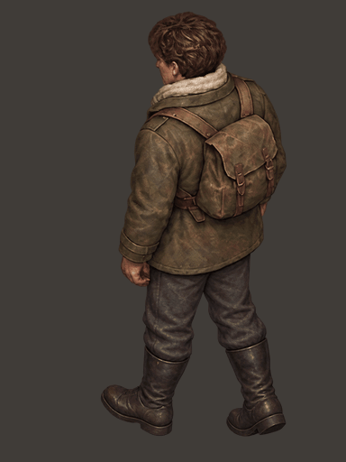
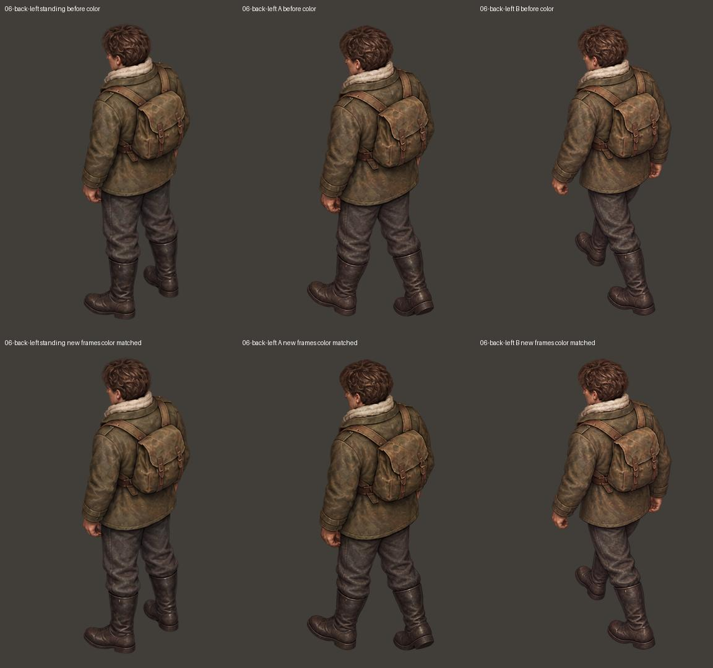
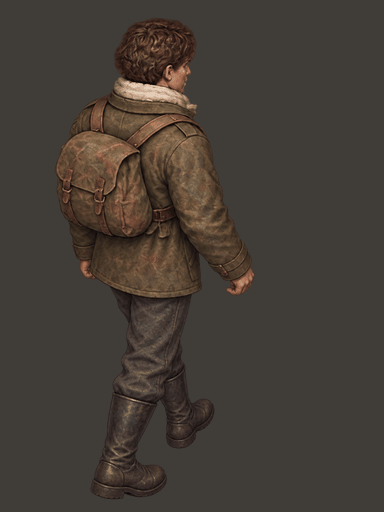
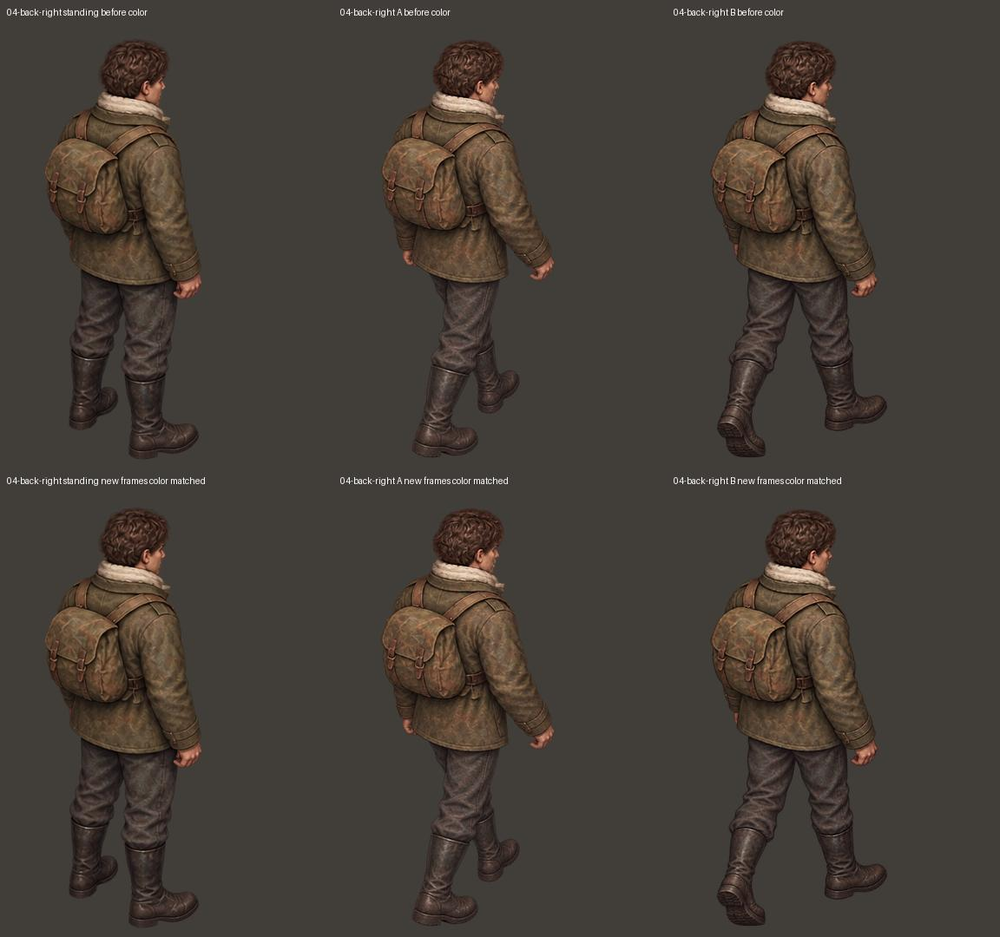

# 后斜方向两张新迈步稿

本次只重新制作左后迈左腿（06-back-left-A）和右后迈右腿（04-back-right-B）。两张的形象参考均仅为最初裁出的对应站姿，没有拿后来生成的人物反复投喂。其余 22 张保留 review04 原文件，逐文件 SHA256 校验见 verification.json。未修改游戏或演示项目。

先看下面两个循环。新稿已经有与已认可的另一步相反的前后脚关系，但仍待你审阅，不宣称最终验收。

## 左后

左后新 A：画面左侧、靠近镜头的一条腿向前落地，画面右侧远腿在后蹬地。原 B 不动。新稿的外套下缘、背包轮廓相对于站姿仍有轻微变化，需要在循环中判断是否可接受。

## 右后

右后新 B：画面右侧近腿向前落地，画面左侧远腿在后蹬地，鞋底部分可见。原 A 不动。

## 文件与检查

- [下载完整审阅包](ivan-targeted-generation-09.zip)：包含原始清晰度两张新稿、24 张基础帧、循环、对照、生成提示词与校验记录。
- preview.html：下载后用浏览器打开，可切换方向、暂停、逐帧检查，也可以关闭插入站姿。无需网络和额外库。
- raw-selected：两张所选新稿的原始输出；aligned-before-color：仅整个人物等比例缩放和头顶对齐后的新稿。
- standing / steps：8 张原站姿与 16 张迈步，其中只有两个待修位置换为新候选。两张新帧未剪贴腿、未镜像、未局部拉伸。
- loops / comparison：固定 A—站姿—B—站姿，两步各 180ms，站姿各 120ms；每个 GIF 共用一张调色板，避免逐帧量化引入额外闪烁。
- 只对新帧进行技术调色，保持 alpha 和轮廓不变；左后衣色校准后，在一个未参与拟合的布料采样区，与站姿的色差距离从 0.0433 降至 0.0302。此数值只反映这个局部，不能代表整个人物闪动完全消失。右后衣色原本接近站姿，未额外调整衣色，只校准裤子中间色。两张图仍有独立生成的纹理和阴影差别。
- 浏览器检查：六种方向/帧状态、原色与调色后同步、逐帧切换正常，alpha 差异为零。22 张已认可源文件字节一致。自动检查不能代替步态审美验收。

## 本次生成记录

共生成 5 张：首轮两张仍画成重复迈步，排除；第二轮右后采用，左后外套偏短，再仅以原站姿生成一次左后并采用。未继续生成装备版。

- 左后采用：exec-969c4421-58d7-4733-b96d-4250f31adb3f.png，对应 left-final-prompt.txt。
- 右后采用：exec-df1966ef-18cc-4452-8fa1-45074d32d7b2.png，对应 right-retry-prompt.txt。
- 早期失败提示词另存 prompts.json、left-retry-prompt.txt，仅作过程记录。

提示词以画面中的腿连接位置、脚的落点、前后遮挡描述动作，同时约束原始头身比例和上身轮廓；不再只靠“左脚/右脚”描述。
