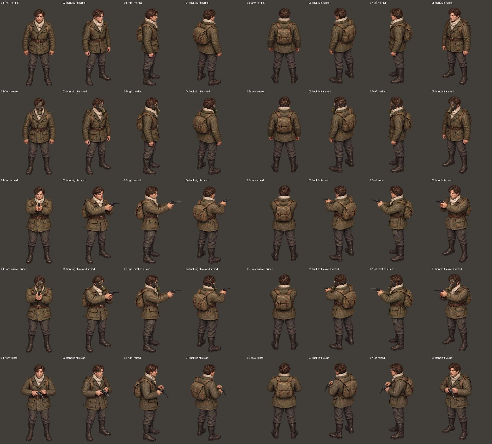
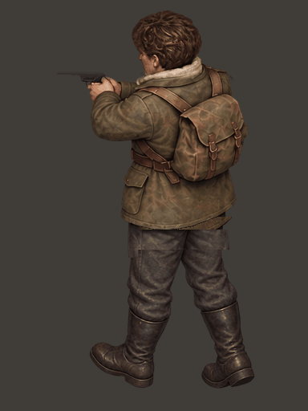
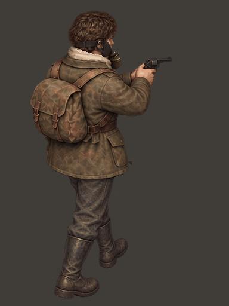
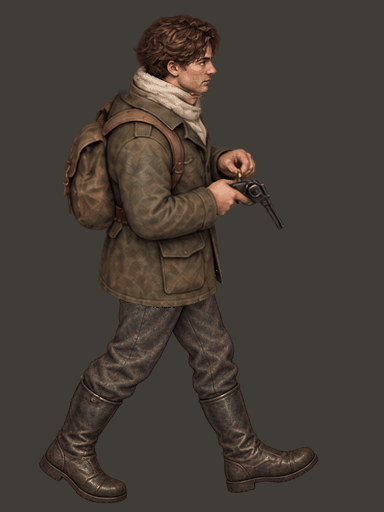

# v20：伊万步态与装备已接入游戏

[下载 Godot 游戏工程 ZIP](https://github.com/2459654640-ship-it/godot/archive/refs/heads/metro-v20-ivan-equipment.zip) · [游戏分支](https://github.com/2459654640-ship-it/godot/tree/metro-v20-ivan-equipment)

基础八方向动作采用已经认可的 review09，微调颜色后接入游戏。新增防毒面具、双手持左轮、换弹上身，并组合成普通、面具、持枪、面具持枪四套图集。没有重新生成整套人物或改变头身比例，没有镜像腿部或用腿部变形伪造另一步。

第 **1** 键拔枪／收枪，**R** 换弹，移动中换弹继续播放左右迈步和站姿中间帧。装备栏、战斗及场景面具切换沿用现有机制。

## 当前人物示意图

以下是运行素材排版，不是游戏实景截图。

- [普通：八方向三姿态](characters/ivan-eight-directions.png)
- [面具：八方向三姿态](characters/ivan_masked-eight-directions.png)
- [持枪：八方向行走与换弹](characters/ivan_combat-eight-directions.png)
- [面具持枪：八方向行走与换弹](characters/ivan_masked_combat-eight-directions.png)

## 重点循环

左后持枪：

右后戴面具持枪：

右侧移动换弹：

## 制作与验证

三个装备原稿均只参考最初的八方向站姿，没有把后续生成角色反复作为形象参考。面具独立覆盖头部，持枪和换弹使用固定上身；原始手部遮挡与髋部接缝用装备画稿处理，源帧 y≥340 的下腿和鞋子逐像素保留。打包后，各装备与移动换弹图集的下腿像素也逐一比较相同。色调微调保持原图 alpha 与轮廓不变。

- prompts.json：装备生图提示词。
- base-color-report.json：24 张基础帧的微调记录。
- geometry-verification.json：图层保留范围与基准。
- validation.json：实际执行的检查结果与限制。
- comparison：每个方向三帧对照。
- loops：每个方向的普通、面具、持枪、面具持枪、移动换弹循环。

本次为无界面运行测试与图像检查，没有新增实际游戏场景渲染截图。历史步态测试用鞋底在画面中的横坐标猜测解剖左右腿，会误判斜视角；现已改为比较从认可原始图片独立生成的脚步轮廓固定样本，保留三帧循环、头部尺度、帧间跳转与真实运行方向检查。

## 全方向循环索引

| 方向 | 普通 | 面具 | 持枪 | 面具持枪 | 换弹行走 |
| --- | --- | --- | --- | --- | --- |
| 正面 | [播放](loops/01-front-normal.gif) | [播放](loops/01-front-masked.gif) | [播放](loops/01-front-armed.gif) | [播放](loops/01-front-masked-armed.gif) | [播放](loops/01-front-reload.gif) |
| 右前 | [播放](loops/02-front-right-normal.gif) | [播放](loops/02-front-right-masked.gif) | [播放](loops/02-front-right-armed.gif) | [播放](loops/02-front-right-masked-armed.gif) | [播放](loops/02-front-right-reload.gif) |
| 右侧 | [播放](loops/03-right-normal.gif) | [播放](loops/03-right-masked.gif) | [播放](loops/03-right-armed.gif) | [播放](loops/03-right-masked-armed.gif) | [播放](loops/03-right-reload.gif) |
| 右后 | [播放](loops/04-back-right-normal.gif) | [播放](loops/04-back-right-masked.gif) | [播放](loops/04-back-right-armed.gif) | [播放](loops/04-back-right-masked-armed.gif) | [播放](loops/04-back-right-reload.gif) |
| 背面 | [播放](loops/05-back-normal.gif) | [播放](loops/05-back-masked.gif) | [播放](loops/05-back-armed.gif) | [播放](loops/05-back-masked-armed.gif) | [播放](loops/05-back-reload.gif) |
| 左后 | [播放](loops/06-back-left-normal.gif) | [播放](loops/06-back-left-masked.gif) | [播放](loops/06-back-left-armed.gif) | [播放](loops/06-back-left-masked-armed.gif) | [播放](loops/06-back-left-reload.gif) |
| 左侧 | [播放](loops/07-left-normal.gif) | [播放](loops/07-left-masked.gif) | [播放](loops/07-left-armed.gif) | [播放](loops/07-left-masked-armed.gif) | [播放](loops/07-left-reload.gif) |
| 左前 | [播放](loops/08-front-left-normal.gif) | [播放](loops/08-front-left-masked.gif) | [播放](loops/08-front-left-armed.gif) | [播放](loops/08-front-left-masked-armed.gif) | [播放](loops/08-front-left-reload.gif) |

## 本轮验证结果

完整 33 组、15,896 项运行断言通过，另有 272 项图集检查通过。Godot 导入通过。收音机测试的 105 项断言通过，但进程退出时报告两个资源未释放；本轮没有调查或修复这一退出提示。见 [详细结果](validation.json) 与 [完整日志](full-regression.log)。
