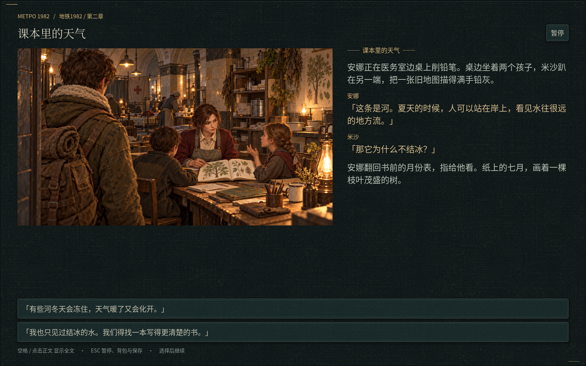
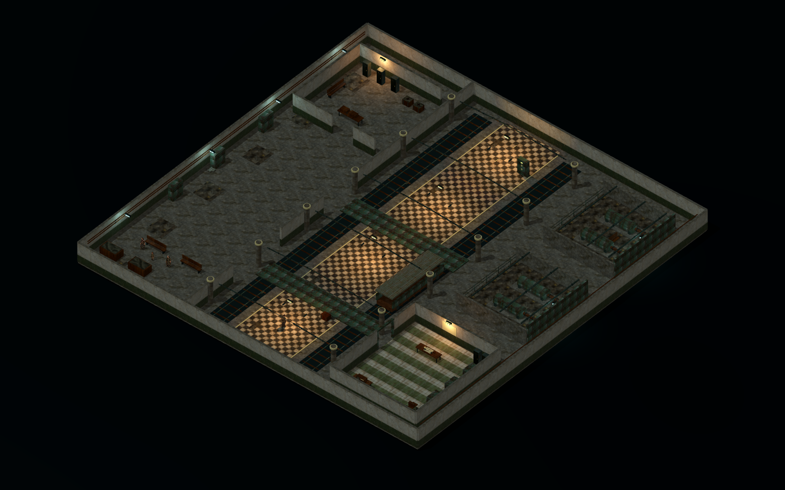

# v22 · 联络线、安娜与未写完的课

[下载 Godot 工程 ZIP](https://github.com/2459654640-ship-it/godot/archive/refs/heads/metro-v22-story-expansion.zip) · [游戏分支](https://github.com/2459654640-ship-it/godot/tree/metro-v22-story-expansion)

这次是可以游玩的剧情更新。公社与谢契各三轮出站主线，新增联络线战区、途中调查与分支对话、持枪对手；安娜从初识课堂、寻亲探视延伸到矿区撤离与两种结果的后续。星城外围推迟到本阵营三轮任务以后，内部继续封闭。

普通伊万基础 24 张与运行图保持原样，三套已认可的 AI 完整人物装备稿接入游戏。新出场位置的安娜、哥哥、伤员与居民复用现有画稿与角色控制器，持枪敌人对齐原角色的世界身高、视角和三姿态步态。

八张新插图，62 个新过场节点（包括分支与抵达），四首原创 MIDI 配乐及其渲染音频；莫罗与家庭记述支线补充了生活后续。原 MIDI 见游戏分支 `assets/audio/scores`。悲剧配乐当前为原创《留给下一班的课》，不是《Here’s to You》；后者保留授权音源替换位置。

《我要你》已替换为新上传的俄语录音，仍在“夜班来信”原位置。新英语频道“远洋值守 / Ocean Watch”配置了《月亮代表我的心》《我只在乎你》的中俄英名称与 MP3 路径；这两份 WAV 均超过当前附件工具 32 MiB 读取上限，未能下载、转码，本包没有这两段音频。两首 MP3 补齐后频道自动启用。

## 查看实际画面

以下均为 Godot 实际渲染，不是美术概念图。

- [联络线控制间](screenshots/railfront-control-room.png)
- [D-6 伤员与广播](screenshots/d6-ward-broadcast.png)
- [阵营任务手记](screenshots/faction-journal.png)
- [撤离前核对](screenshots/rescue_review.png)
- [安娜生还后的日常](screenshots/anna_living_lesson.png)
- [地表一课](screenshots/anna_surface_visit.png)

[剧情条件与测试范围（含剧透）](剧情条件与验证.md) · [全部收集品原位置](../v19/全收集品位置-v19.md)

建议另开存档体验前段新增剧情；旧存档保留物品、刊物、报酬和经历，不会自动给安娜判定结局。工程文档只放当前素材示意图和最新地图全景，历史截图都在本资料分支。
