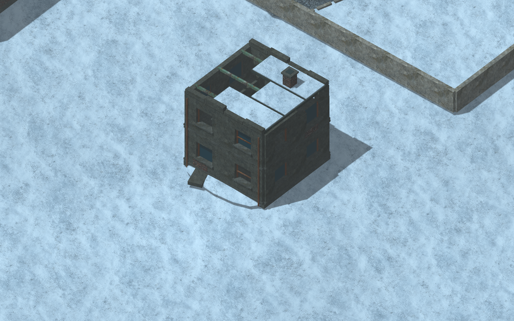
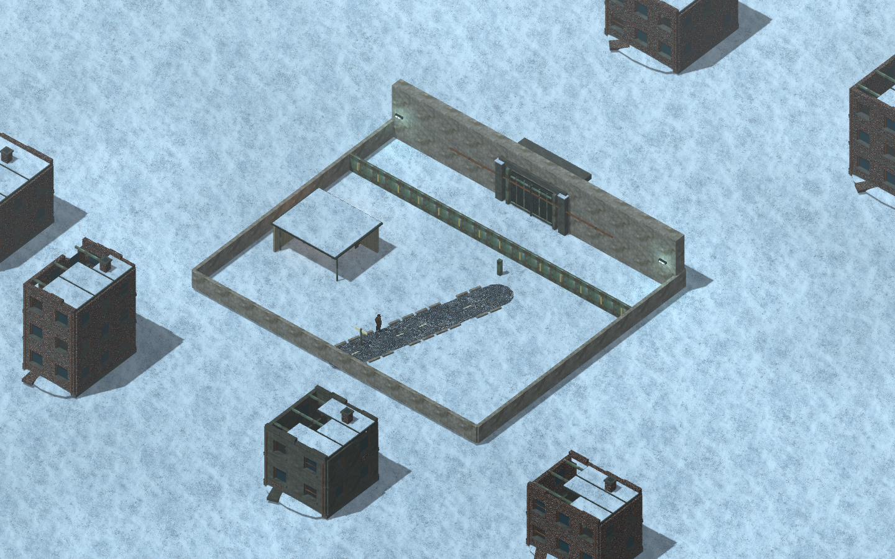
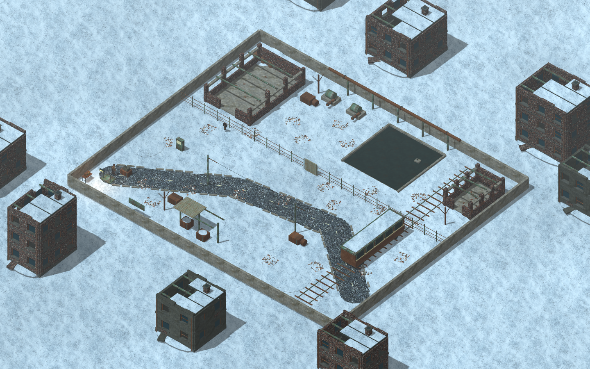
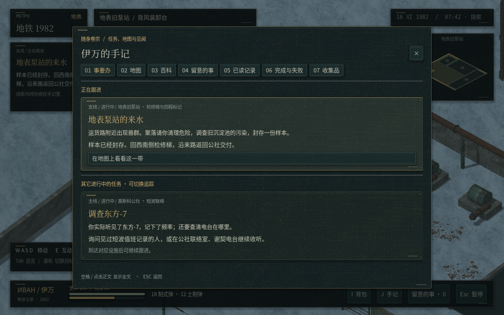
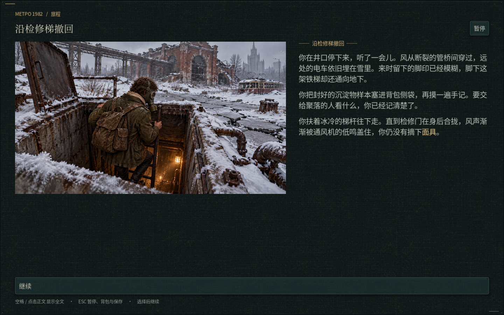
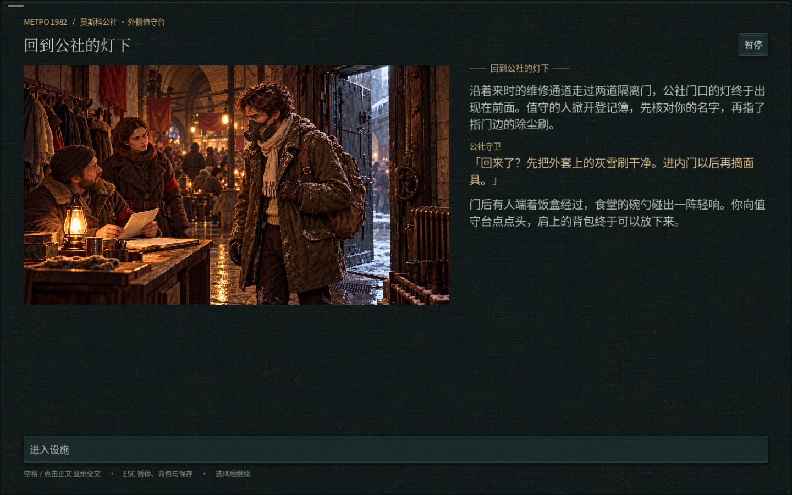
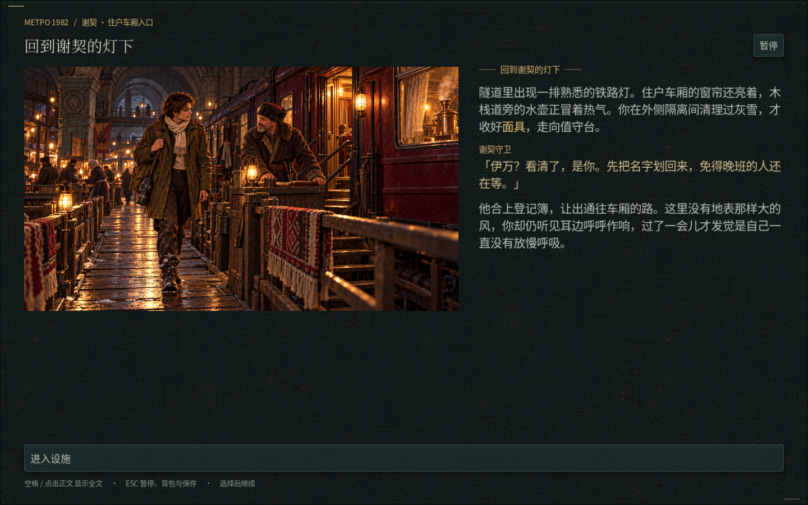

# v23 · 地表废墟、绕障与归途

[下载工程 ZIP](https://github.com/2459654640-ship-it/godot/archive/refs/heads/metro-v23-exterior-routing.zip) · [当前代码](https://github.com/2459654640-ship-it/godot/tree/metro-v23-exterior-routing)

这次集中处理室外建筑、战斗追踪、旧泵站任务指引与返程画面。沿用 v22 剧情与已认可的人物图集；普通伊万和三套装备人物没有重画。现有存档可续玩。

## 室外场景

星城外围与旧泵站是独立的 `starcity.tscn`、`surface.tscn`，没有合并。星城内区继续封闭。

两图的城市废墟以及水处理厂外的城市背景使用同一套新建筑构造：四面墙、实际窗洞、窗框与凹进的残余玻璃、楼板、内部隔墙、局部破损屋顶、积雪、烟囱与落水管。旧砖、破灰泥、混凝土与铁皮采用现有贴图，并保持世界空间纹理尺度。建筑位于探索范围外，不会把场景远景变成新的碰撞障碍。

星城外围调整室外光照，并补门框、门扇加强筋、等候棚屋顶和旧道路。工程的 docs/maps 仅更新这次改动的三张当前地图全景。

## 怪物绕障

敌人单独使用能避开矮池沿与路缘的导航网格。移动前用真正的碰撞体检查能否跳过路点，拥挤时让路，受阻时重新规划。薄墙挡住近距离目标时先绕行，不能隔墙攻击。持枪敌人同样绕障，取得清楚射界后再开火。门动画结束重建导航时，敌人同步取得新路线。

专项测试实际运行怪物与士兵的 CharacterBody3D：绕低池沿、绕薄墙、关闭门不可穿过、开门后继续追踪、绕高掩体开火、三只怪物通过同一箱体两侧。没有用瞬移越过障碍。

## 任务与返程

出发去旧泵站会追踪“地表泵站的来水”。旧存档仍追踪“调查东方-7”时，广播线索也不会冒充地表的本地任务。读取记录、排水、取样、返回检修梯与交付使用各自的地点；在谢契接取任务时，准备地点同样是谢契。

手记的其他待办显示“其它进行中的任务 · 可切换追踪”，避免把未追踪误读为尚未开始。未接受的任务仍不显示。

新增三张 AI 剧情插图：

- [泵站检修井返程](https://github.com/2459654640-ship-it/godot/blob/metro-v23-exterior-routing/assets/cinematics/pump_hatch_return.png)
- [公社值守台](https://github.com/2459654640-ship-it/godot/blob/metro-v23-exterior-routing/assets/cinematics/pump_return_commune.png)
- [谢契车厢入口](https://github.com/2459654640-ship-it/godot/blob/metro-v23-exterior-routing/assets/cinematics/pump_return_sech.png)

返程先表现从井口撤下，再到各自聚落入口。未取得样本时描述撤退与补给，取得样本时描述保管封口和记录；不会凭空增加物品。画面中的伊万在地表佩戴面具，进入安全区后才收起。星城返程也使用相符的聚落入口画面，不再借用 D-6 小队乘车图。

## 实机截图

以下均由 Godot 4.6.3 实际渲染。任务图将存档设为已取样、旧广播仍处于手动追踪状态，检查它能否自动改为当地可执行的任务；不是新建人物直接跳到该处的正式流程。

完整检查结果、代码提交和日志见 [validation.json](validation.json) 与 [logs](logs)。历史截图只存在本资料分支，没有放进游戏 docs。
