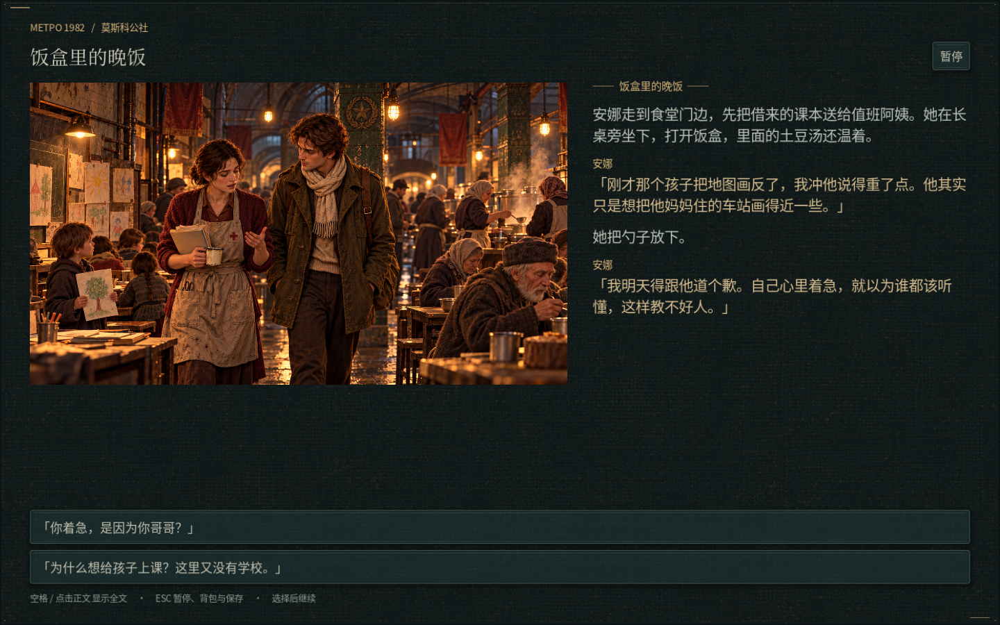
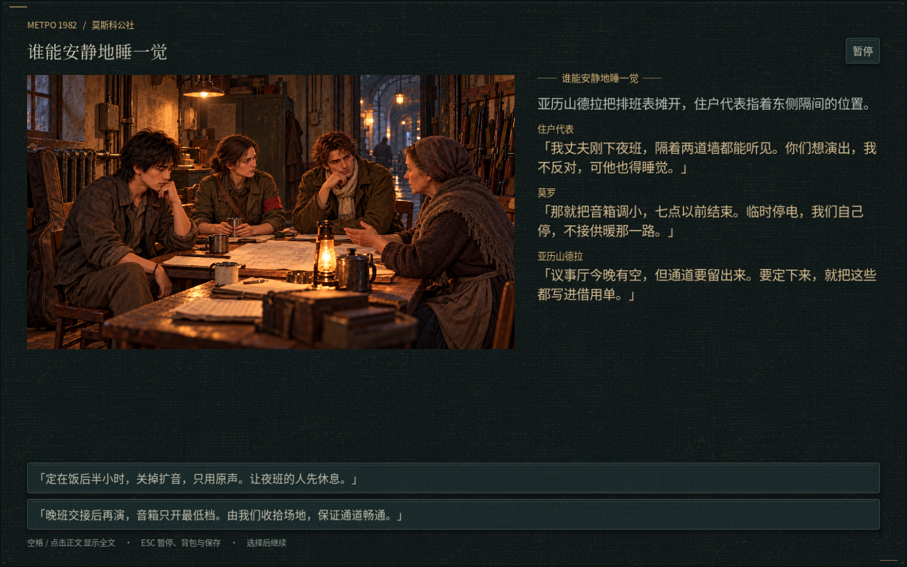
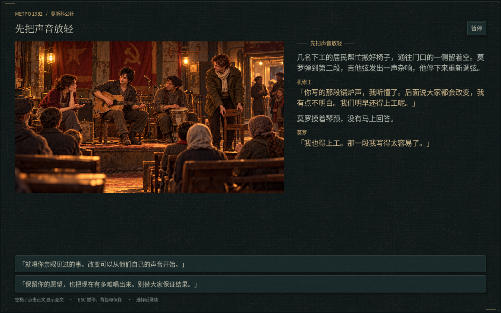
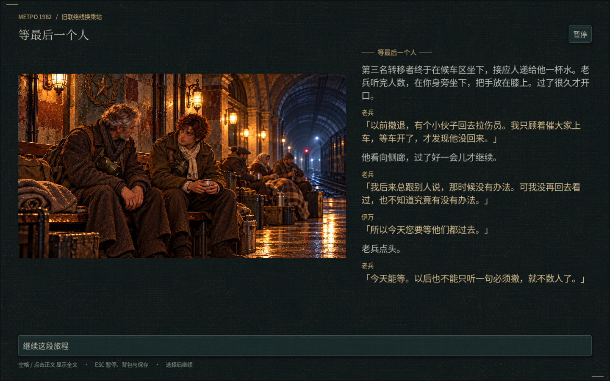
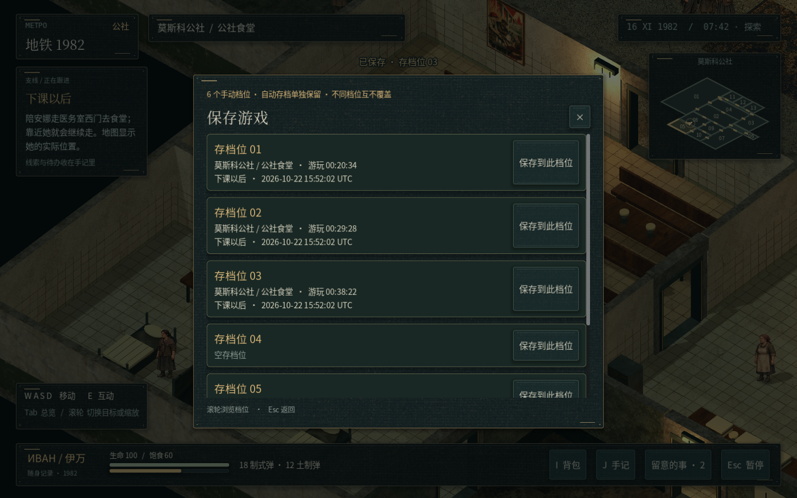

# v24 · 同行的人与轮班之后

[下载工程 ZIP](https://github.com/2459654640-ship-it/godot/archive/refs/heads/metro-v24-living-stories.zip) · [查看代码](https://github.com/2459654640-ship-it/godot/tree/metro-v24-living-stories) · [完整文案 Word](copy/metro1982-v24-copy.docx)

## 安娜：下课之后

看过她的课堂后，可以陪她从医务室西门去食堂。她会停下来等伊万；聊天与调查哥哥是分别同意的两件事，可以先听她讲教书、一次不耐烦的失误和想带孩子看地表的愿望，再决定是否接受调查。暂时没空同行，也可以明确选择先听她说明来意。

安娜去矿区后，公社里的她暂时离开，课桌留下去向提示。救援结果会对应人物的存亡、哥哥的归来和之后的生活；生还后还能听到她与哥哥准备新课的片段。已经接取、完成的旧调查不会被迫重做。

## 莫罗：一起筹备、协商和试演

莫罗会自己走到机修间、锅炉房和守备班，完成当前工作后再进入下一步。寻路计入打开的门扇和其他居民，人物实际到场后才能共同拆检、接电和商量场地。地图目标跟随人物的位置；离开地图再回来也保留等候地点。

场地协商有住户休息与轮班的具体分歧，可以选择原声短演或交班后低音量演出。准备完成后先参加试演，听机修工对歌词提出意见。协商条件与歌词建议会实际写进正式演出的过场，之后仍能选择公开演出或小规模排练。

## 老兵：等最后一个人

在水厂支持老兵离队、随他前往公社后，可在联络线任务中与老兵谈接应居民。玩家与老兵守住西侧交叉口，三名转移者依次实际走到南侧候车区；三轮来袭随撤离进度接入，共七只敌人。需要威胁清除且三人抵达才能完成。老兵守在接应口协助射击，玩家仍可救援倒地的老兵，每轮交火保留无损重试检查点。

收尾发生在候车区，老兵谈起从前一次没有清点人数的撤退。奖励领取一次，之后继续当前阵营任务。

## 阶段、存档与美术

- 安娜、莫罗、巴拉诺娃的长委托按当前阶段开放，减少同时接下一堆任务；主线与已接取的旧任务可以继续。
- 同行没有后台倒计时和等候失败；离开地图、读档和人物增减均有对应处理。
- 安娜、莫罗保留原站姿像素，补完整绘制的两种迈步姿态，统一脚底基线与适量色调；没有拼接腿部。
- 伊万普通、面具、持枪、面具持枪四套贴图逐字节保持原样，验证见 [素材核对](validation/asset-validation.json)。
- 新增四幅剧情画面，并修正过场解析后出现内部人物标识的问题。
- [动作联系表与动画预览](art-review) · [打包用 AI 原图](sources) · [游戏内截图](screenshots)

## 六个档位、随时保存与回档

F5 打开保存列表，选择 01—06 中的一个档位；F9 打开读取列表，选择想回到的进度。已有存档覆盖前确认，六个手动档位互不覆盖；三个轮换自动存档和旧版快速存档在单独的读取页保留。主菜单同样提供档位读取。

每份存档记录角色位置与朝向、物品和数量、子弹与交易状态、生命与饱食、任务分支及完成情况、人物初识与对话解锁、全部已发生的对话记录、已读内容、收集品、剧情面板和选择进度，以及重要 NPC 的当前位置。档位卡片显示地图、房间、游玩时长、正在跟进的任务和保存日期。

交火中也能保存：敌人的位置、血量、攻击准备、弹药、当前装填和老兵状态均随档位保存；读取后恢复当前战斗。原来战前的重试检查点另行保留，选择“重试”仍恢复战前资源。

保存、读取与覆盖列表开启时，任务／物品通知不会遮住标题和存档内容；通知会在关闭界面后继续显示。写入仍保留校验与有效备份，单个损坏存档不会覆盖其它档位。

## 文案与验证

[Word 校订本](copy/metro1982-v24-copy.docx) 导出当前合并后的全部文案、触发条件、分支、任务阶段与源位置，共 4,349 个文字来源，覆盖检查无遗漏。新流程位于 living_story / living_panels 与 living_world，仍保留此前的剧情参考和既有分支。

整套 41 组测试通过，合计 16885 项检查；覆盖剧情、场景、同行、协商、三轮撤离防守、存档与回档，并单独检查测试工具不会留下对原存档的改动。详细结果见 [验证摘要](validation/summary.json)。截图通过 Godot 实际渲染，历史版本资料仍留在此独立资料分支。

旧存档可以继续；已经完成的初识、调查和演出不会重置。要体验新增的早期同行与筹备，请使用接取这些人物任务之前的存档或新存档。
