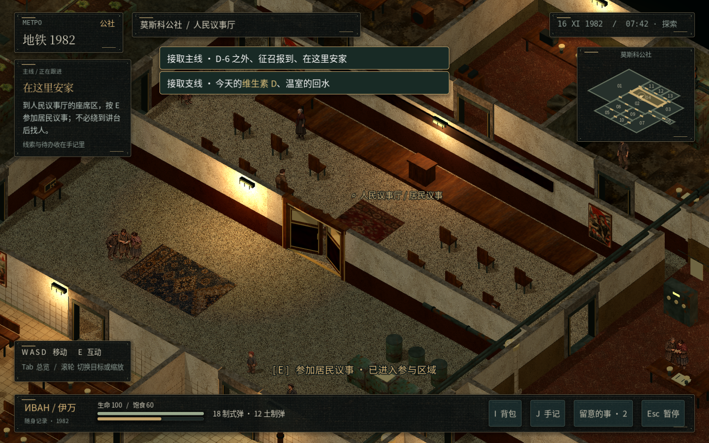
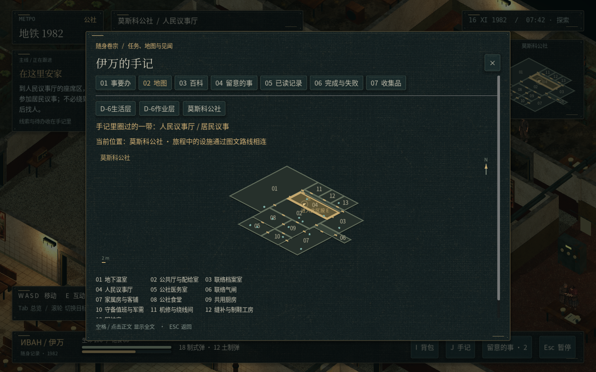
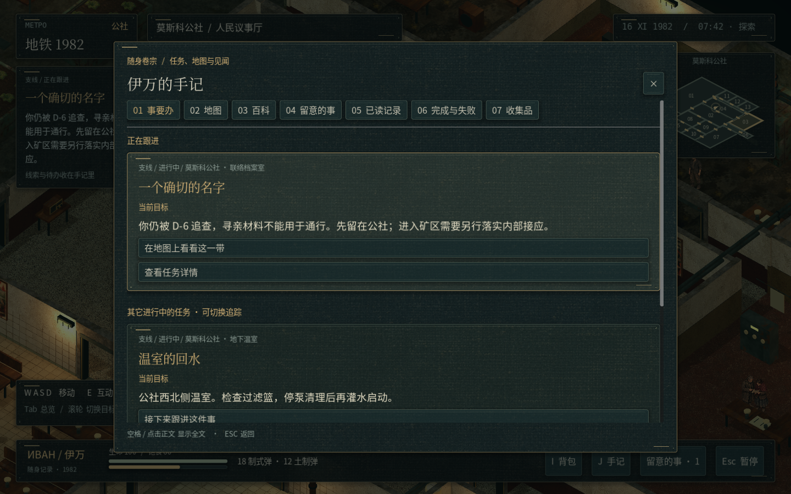
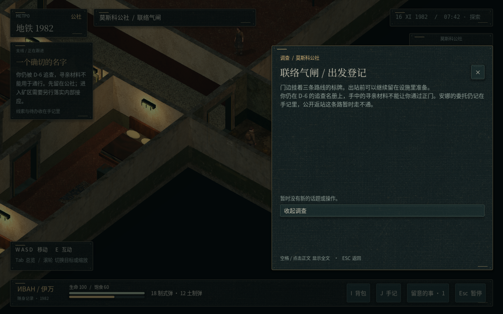
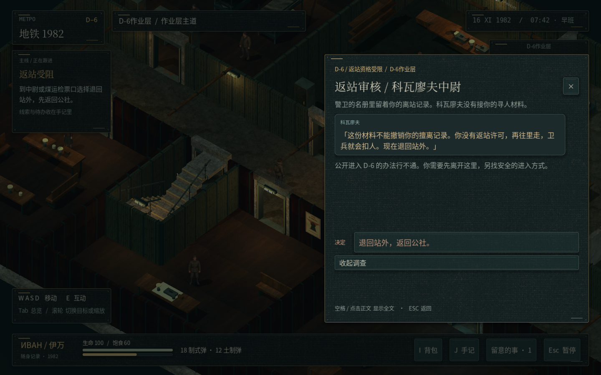

# 互动与 D-6 身份修复 / 玩法讨论

代码提交：`3756ca75b303093f207c9a5a5a81fa67a9b7d1b3`。本轮为修复补丁；剧情、背包与经济大更新仍是方案。

- [剧情与玩法更新讨论稿](剧情与玩法更新讨论稿.md)：包含返站章节、阵营关系、安娜线与《逃离塔科夫》式物品/背包/商店建议。
- [下载当前 Godot 游戏工程](https://github.com/2459654640-ship-it/godot/archive/refs/heads/metro-v26-creature-combat.zip)。
- [验证结果](validation.json)：16 组回归、4344 项检查通过，另完成实际画面检查。四套已验收伊万贴图未改。

## 当前修复范围

活动采用房间内参与区域，地图标明范围或当前目标位置。D-6 的公开返站检查覆盖对话、行动、旧过场和地图跳转；公社的寻人材料不能洗掉擅离记录。正常交回滤芯、归家及既有 D-6 外勤保留。

**注意：秘密接应和潜行章节尚未开放。**逃亡者的重新返矿与公社矿工联络阶段暂缓，任务和线索保留，不判失败；已经在矿区的旧存档可完成当前探访后离开。不能把本补丁当成已经完成新潜入章节的大版本。

## 实际游戏截图

### 进入议事厅即可参加

### 展开地图可见参与范围

### 任务明确说明返站受阻

### 公社材料不能用于 D-6 通行

### 旧作业层存档可以退出

