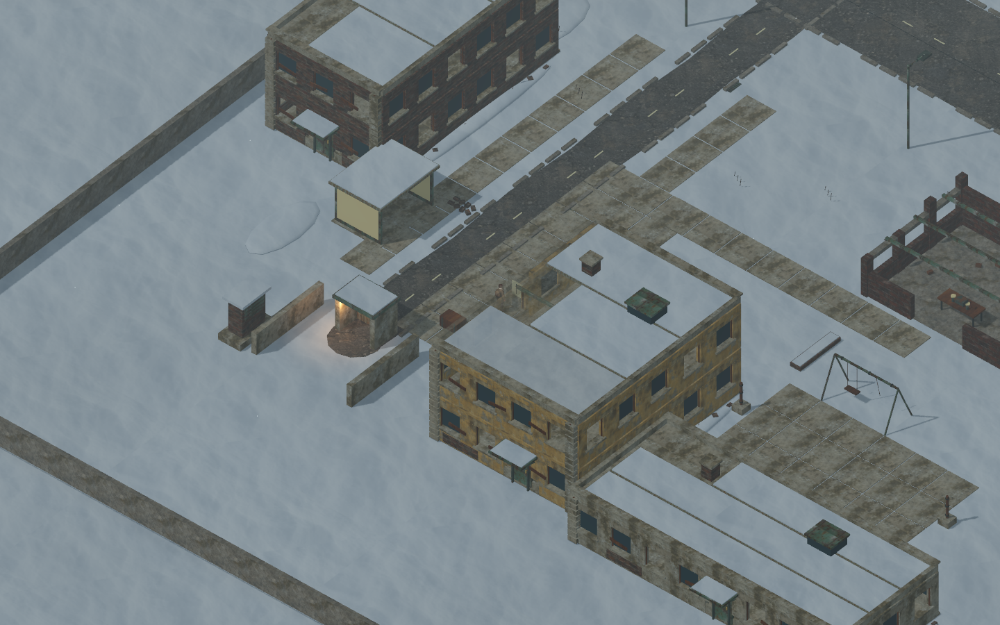
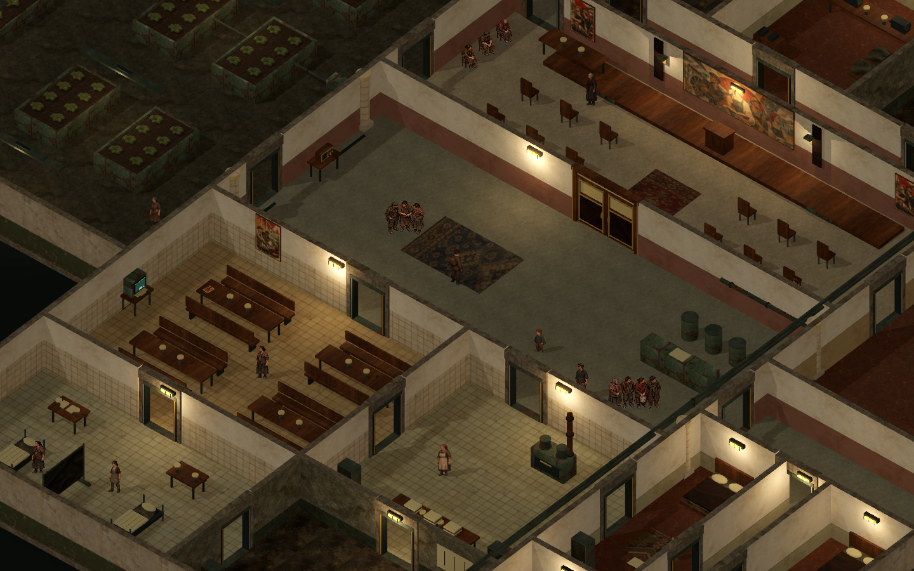

# v28：重制第一批实装与场景方案

已确定方向：**地上半开放大地图＋独立室内箱庭探索**。美术优先，结合苏式工业、地铁、核冬天和原子时代设备；画质可分档。当前只是第一批实装，完整大地图、室内全面重建和后半部剧情尚未完成。

[工程分支](https://github.com/2459654640-ship-it/godot/tree/metro-v28-art-direction) · [下载工程 ZIP](https://github.com/2459654640-ship-it/godot/archive/refs/heads/metro-v28-art-direction.zip)

对应工程提交：`677cf921ff199926b9d82a3c68f6e42beaa968cc`。

这是 Godot 4.6.3 工程，解压后导入 `project.godot`。不是已导出的 Windows 可执行游戏包。主菜单可新建游戏或读取旧档；本轮保留伊万四套认可图集。

## 优先看这几处

| 内容 | 预览 |
|---|---|
| 西南入口：沿街住宅、候车棚、导向图与背巷 | [当前实景](review/urban/station-approach.png) · [修改前](review/before/east_district.png) |
| 住宅院落与维修间的步行连接 | [当前实景](review/urban/courtyard.png) |
| 水厂外立面与锯齿采光屋顶 | [当前实景](review/urban/factory-entry.png) |
| 检修库拱形钢屋顶 | [当前实景](review/urban/depot.png) |
| 东郊局部布局 | [当前全景](review/urban/overview.png) |
| 公社材质、壁画与照明 | [高画质](review/quality/commune-quality-2.png) · [极致](review/quality/commune-quality-3.png) · [修改前](review/before/commune.png) |
| 画面设置 | [实际设置界面](review/quality/settings-four-presets.png) |
| 材料分类与专用物品图标 | [背包](review/quality/inventory-high.png) |
| 聚落实体寄存柜 | [界面](review/interface/storage.png) |

环境实景使用实际游戏内容渲染，不是概念图。`quality`、`urban` 为 Forward+；`before` 和 `interface` 为 Compatibility 渲染，构图用于比较但不能用来推算性能。十张地图的最新全景放在[游戏工程 docs/maps](https://github.com/2459654640-ship-it/godot/tree/metro-v28-art-direction/docs/maps)。旧泵站与星城外围仍是两张独立地图。

## 实装范围

- 西南入口街区加入住宅、院落、背巷和步行连接；外部建筑按住宅、水厂、泵站、检修库区分屋顶、入口和附属构造。原任务入口保持可达。新增楼房暂不开放内部。
- 新增四张环境材质、议事厅马赛克和三种材料图标。修复环境贴图的缩小采样，调整工厂地板采样与各地图光照。
- 桌面默认 Forward+。流畅、标准、高、极致四档实际调整渲染比例、抗锯齿、阴影、环境遮蔽、泛光和间接光。兼容渲染器明确说明不支持的效果；画质不会改变地图路线、碰撞或任务。
- 探索 HUD 收紧，背包按类别整理并显示实际效果和收购价值。D-6、公社、谢契的实体寄存柜分别保存补给与材料，不能远程跨聚落取用。
- 探索音乐按地点选曲，曲间留白75秒；普通对话不中断已经播放的音乐。本轮使用工程内既有音乐，没有新增录音。
- 修正文案中敌对阵营的官方探访文件矛盾；正常征召出站不再统一判站内任务失败；维生素提醒不会在后续每段过场结束时重复出现。

## 仍未完成

地表仍为160×120米局部，较大区域与分区加载尚未实装。很多环境物件仍需继续精修，室内布局尚未依重建设计逐张替换。完整仓储经济、武器改装和更多探索设施也未完成。本批改动不代表游戏已达到商业发行标准。

星城只开放外围；三条阵营线保留，内部、父亲与终局部分先提交方案。没有擅自把候选结局接入游戏。

## 设计文件

1. [重制制作书](design/重制制作书.md)：整体美术、世界年代、制作顺序、UI、物品、声音与验收。
2. [场景重建分图设计](design/场景重建分图设计.md)：地表连接图、室内功能与流线、各图目前完成到哪里。
3. [星城与后半部剧情详细方案](design/星城与后半部剧情详细方案.md)：三条阵营的不同经历、安娜两种结果、分阶段进入星城、父子重逢与四类候选结局。供讨论，未实装。

## 验证记录

51组回归检查、19298项断言通过，涵盖原有任务、身份限制、跨图、存读档、战斗、潜行、交互与新增寄存柜。新增检查覆盖五处改建地块中的旧存档站位迁移、院落通路和画质确认／恢复。

[逐组检查结果](validation/results.json) · [实际渲染档位](validation/rendering.json) · [新素材与原角色校验](validation/assets.json)

另用 Vulkan Forward+ 生成实景并逐图检查。云端使用软件 Vulkan，因此没有提供消费级显卡帧率结论；自动测试通过也不能替代完整人工游玩和美术评审。
