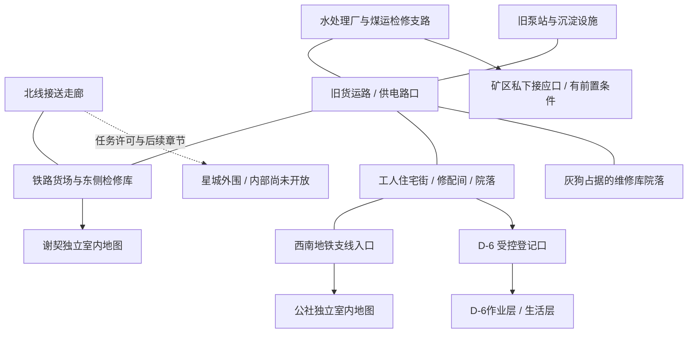

# 地表与室内：场景重建框架

2026-10-24。方向已确认：地上半开放大地图，地下聚落与设施内部为独立的箱庭式场景。以下将当前实装与后续设计分开，避免把规划图当作可玩内容。

## 地理骨架

地表的连接依据是道路、货运铁路、地下检修设施与旧居民区，而非任务排列顺序。地表入口通向地下联络线，聚落可以位于更远的隧道内。公社、谢契和 D-6 不需要在地面上成为相邻的三栋楼。

此图表达连接关系，不表示比例和确切距离。当前已实装东郊 160×120 米局部；约 1.2×0.9 公里的后续区域仍是建议范围。扩大以前必须先完成每个街区的活动、遭遇、回程方式和视觉地标。

## 当前第一段街区实际改动

西南地铁口—路边导向图—维修间之间增加沿街建筑和连续步行面。两栋住宅、一处旧洗衣房与转角住宅围出院落，保留背巷；废弃秋千、长椅、供暖立管与封存门表现原有居民生活。水厂旁增加附属工房。

水厂屋顶改为锯齿采光形式；泵站和检修库使用分段拱形金属屋顶；住宅使用楼层线脚、阳台、雨棚和带损坏的平屋顶。厂门、地铁口和建筑门前有不同的地面处理。任务交互坐标不变，新增实体建筑参与碰撞和寻路；旧存档落在新建筑内会转移到近处的有效站立点。

这一区段是空间与材质的第一轮实装。当前车体、植被和许多街道设备仍是较粗的几何体，地表整体也仍显稀疏，需要继续制作。新增楼房暂不开放内部，不伪装成可进入的探索设施。

## 各室内地图的空间设计

### D-6

保留玩家已熟悉的生活层主干道和上下层关系。扩充重点在作业层：物资与伤员分别从运输口进入，医护床位沿主通路侧面排列，登记台可以看见入口，煤运入口位于工作限制区。宣传广播覆盖公共区，伤员和缺少包扎用品的护理工作在同一时刻可见。

生活层用门口鞋架、修补衣物、配给容器与家庭物件体现二十年居住。新增家具以真实用途和使用人数为依据。身份规则作用于岗哨、楼梯和矿区门，受限来访者不能在过场结束后直接获得整张地图的自由通行。

### 莫斯科公社

公共厅是连接空间，承担公告、偶遇、等候与活动集合。议事厅应较紧凑，有讲台、面向讲台的座位和两侧可走通道；后台侧门通向印刷和联络室。食堂与厨房、储藏连通，避免厨师端着食物必须穿过议事厅。种植区连接水泵与生产工房，蘑菇培育间单独处理湿度与遮光。

居住区通过短支廊分成住户隔间，床、储物、暖气和窗帘留出正常使用位置。课堂靠近住户但避开锅炉与武装值守。守备班靠出入口，军需和武器储存有受控房间。莫罗的锅炉房既是实际设施，也是他工作和排练协调产生冲突的地点。

材质分工：主厅磨损水磨石、餐厨瓷砖、生产区混凝土、居住区旧油毡与小块织物。马赛克和印刷宣传布置于人们会停留的墙面，不能挂满每条走廊。照明在公共活动区温暖，在工房偏中性；墙角保持阴影，但门和人物可辨认。

当前只完成一轮材质、壁画和灯光调整，尚未按本节全面重建布局。

### 谢契

以旧车辆检修库为建筑外壳，两条连续停用股道承载改装车厢；跨轨通路设置齐平踏板。车厢下能辨认底盘与转向架，车体端部弧度、连接风挡和门的位置一致。居民从侧门进入，不从车体整面缺口穿行。

住户车厢、公共餐车、书室、工房与议事空间形成两个小院式公共节点，以检修步道连接，避免单条长走廊串联所有房间。炉火、共用桌、工具架与织物分布在这些节点。议事厅可以利用库房里的固定空间，不必把每个功能都强行塞进车厢。

帘子、床、座椅和长老站位按人体空间检查。群体NPC沿桌边或墙边面向公共空间，不能堵车门。当前场景尚待上述结构重建。

### 水处理厂

根据工艺组织路线：入口气闸与值班记录—泵房—卸压与检修支路—供电间—滤芯仓库。主路线形成可理解的环路，完成卸压后可打开一条回程捷径。档案室处于值班管理区，不埋在一排高设备后面；控制面板与其控制的设备之间存在可以追踪的管线或编号。

泵、电机、阀门、支架与仪表按实际连接关系建模。水管与电缆分开走，管路穿墙有套管，高处管桥会随遮挡程度淡化。设备间湿冷，档案与配电区域相对干燥；仓库有卸货尺度的门。战斗房间提供可以绕行的设备和清楚的攻击空间，怪物不会只在门框处排队。

当前已补一轮仪表、设备底座、材质采样及照明，外立面改为工业采光屋顶；上述完整室内工艺环路尚未重建。

### 煤运区与星城外围

煤运区必须表现工作、交班、医护与受控运输的不同流线，接应路线和公开路线在空间上分开。安娜线的救援要先确定担架能否通过、谁在哪里等候、出现危险时为什么不能简单从原路走回去，再写分镜。

星城外围保留去污、等候、物资交接、外线维修和多重门禁。普通外来人只能到这一层，不能看见内部完整设施与父亲工作台。正式内部结构与终局关卡需要先讨论后半部详细方案，本轮不开放。

## 如何让探索有内容

每个可探索设施至少要有：一个能在远处认出的外形、一个可理解的进入理由、一条主要路径、一次路线或资源选择、一处观察所得的线索，以及值得带回的物品或信息。设施之间的路不是无限重复战斗的走廊。

灰狗营地作为人类庇护所设计：岗哨观察入口，睡铺远离火线，食物与燃料有遮蔽，后勤缺口能够作为潜入路线。潜行与战斗用同一组实际碰撞和视线规则。区域刷新不能重置已拿过的剧情文件、破坏性选择或已救出的人。

较大的区域完成以后，可以通过恢复供电、修通联络门和短途运输减少重复赶路。室内入口前保留方向提示与整理装备的空间，加载结束时玩家站在明确的入口内侧，离开时回到同一地表位置。

## 每张地图交付时检查

- 正常游玩视角、总览与门口近景均能解释建筑结构；效果不能只存在于概念图。
- 从入口逐个走到任务区，确认有足够宽的路、真实碰撞和清楚的交互目标。
- 桌椅面向用途，床与柜门有使用空间，海报贴合墙面，地毯不拉伸成走廊长度。
- 带着旧存档进入，人物、掉落、门和已完成任务保留；旧站位与新结构冲突时有安全迁移。
- 高画质与低画质拥有相同的物件、掩体和路线，只改变渲染成本。画质不改变剧情、战斗和探索内容。
