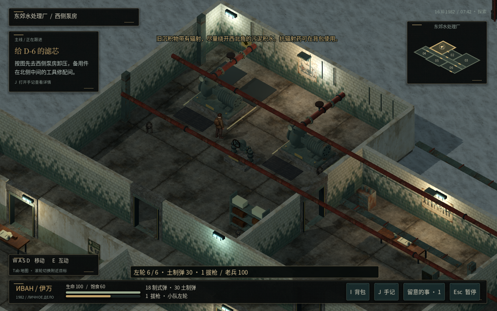
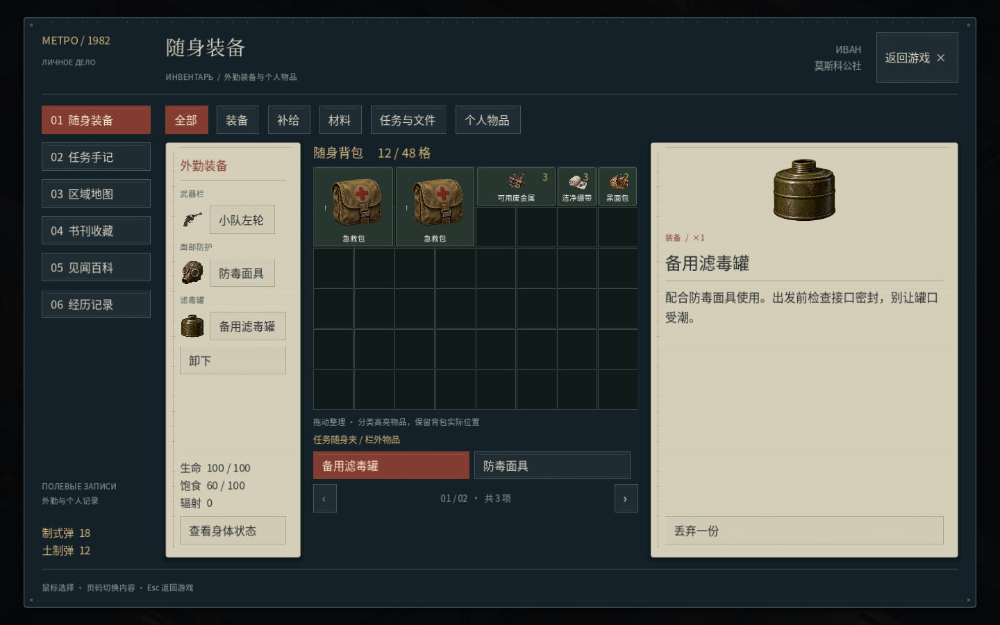
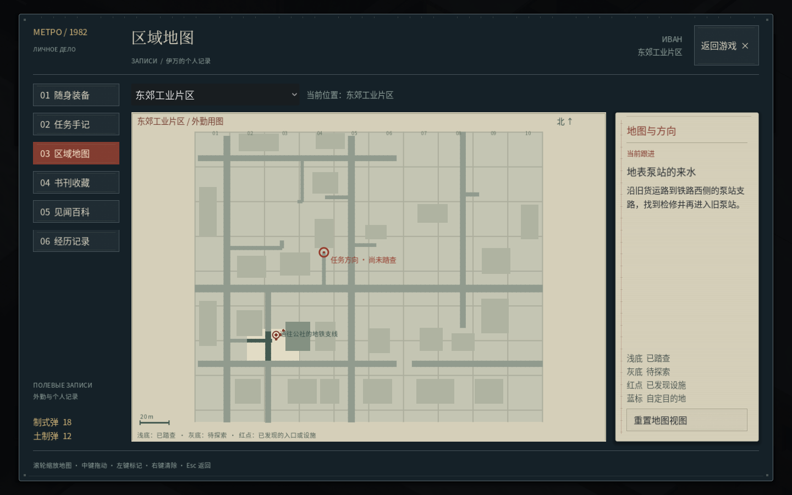
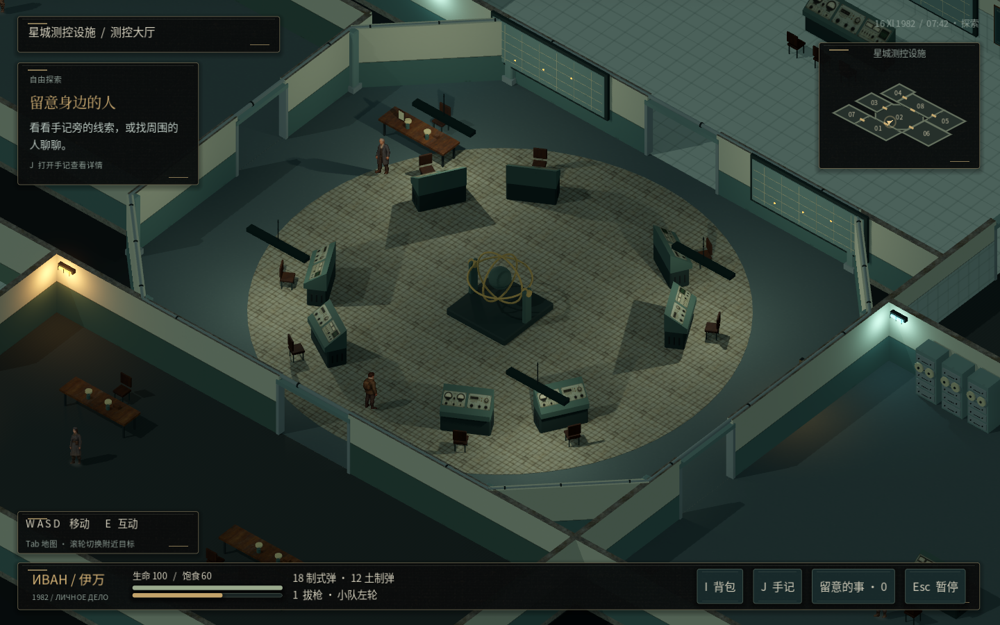

# v34 场景与体验打磨

[下载独立游戏包](https://github.com/2459654640-ship-it/godot/archive/refs/heads/metro-playable-windows.zip) · [源工程](https://github.com/2459654640-ship-it/godot/tree/metro-complete-rework)

完整解压后运行 Metro1982.exe，保留 content 文件夹。Linux 可运行 Metro1982.x86_64。Windows 真机验收待进行。

本轮重做水厂机组、旁通阀、陶瓷墙与混凝土地坪；城区锅炉房与装卸构件、公交候车节点；星城切角测控大厅及科研房间饰面。统一背包、手记、地图、商店和对话的纸张／仪器界面语言，补充已接任务的作业目的、路线、交接和战斗后下一步。

修复双光标：手动拔枪只显示游戏准星；打开界面、对话、过场、死亡和切出窗口恢复系统鼠标。实际窗口检查已记录。伊万已认可四套图集保持不变。

[全部实景截图](screenshots) · [更新的地图全景](maps) · [结构尺寸与建模方法](design/场景制作与建模取舍.md) · [检查范围与日志](validation) · [v33 完整剧情流程、全文案 Word 与全收集品位置](../v33)

## 水厂与 UI 实景

本轮有 22 套相关检查通过。代码与寻路检查不等同于美术或商业品质认证；本次结构重制范围见制作说明。
