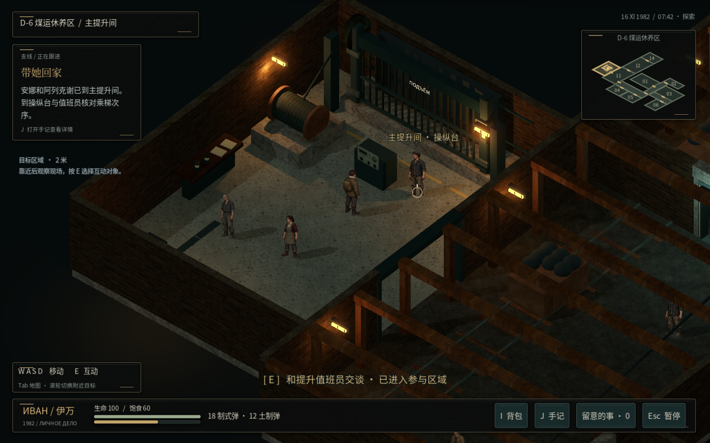
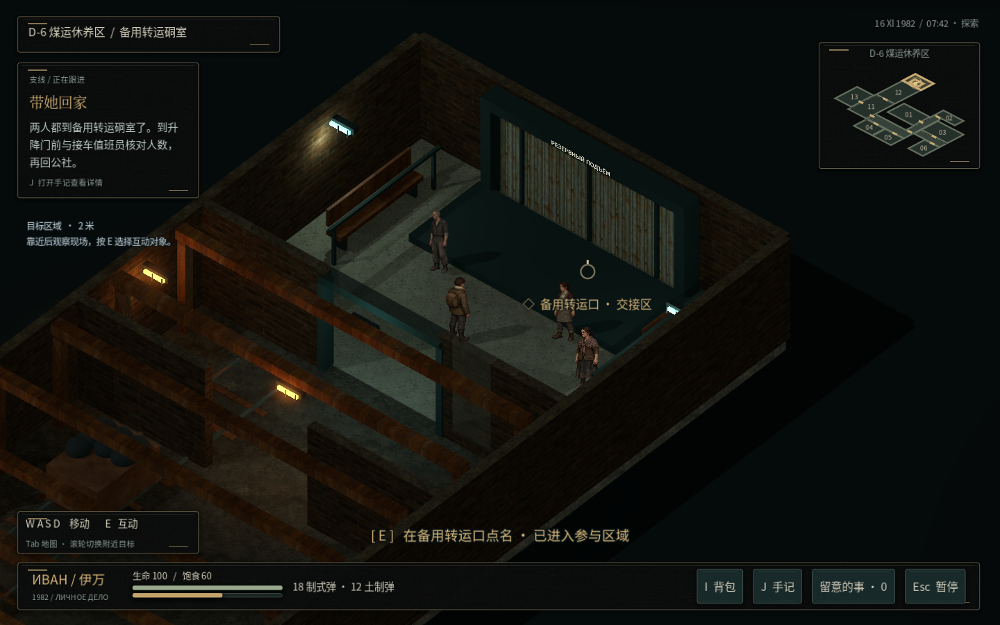
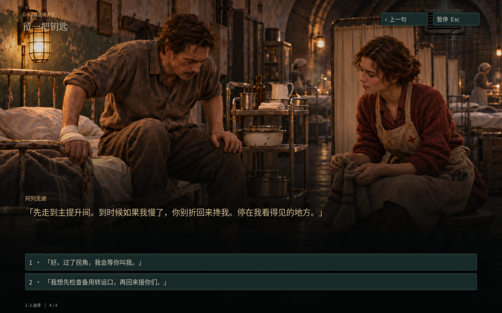
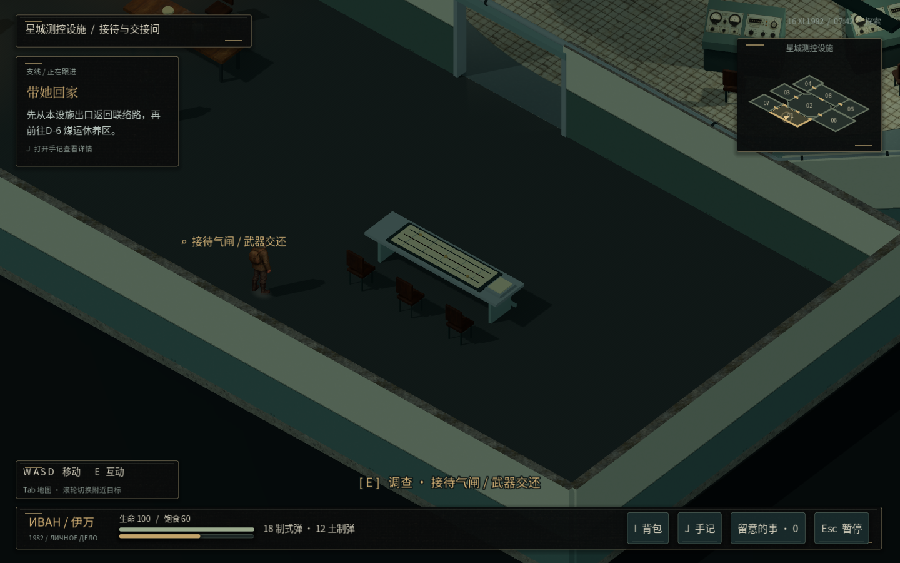

# 地铁1982 v35 剧情重制候选版

[下载独立游戏包](https://github.com/2459654640-ship-it/godot/archive/refs/heads/metro-playable-windows.zip) · [源工程](https://github.com/2459654640-ship-it/godot/tree/metro-complete-rework) · [场景、玩法与操作重制讨论稿](design/rebuild-discussion.md) · [测试记录](validation)

完整解压后运行 `Metro1982.exe`，保留 `content` 文件夹。Linux 可运行 `Metro1982.x86_64`。更新游戏目录不会覆盖原用户存档。

序章交代伊万母亲为何等不到北线回话。三条阵营线让伊万看到登记、送达和执行之间的差距。星城的重逢将这条线索交到玩家手里，四种终局用实际的预警、接车或交接回应它。终场对话与写给老爹的信随决策变化。

安娜线的关键转移改为可以亲自完成的章节。主提升间与备用硐室有真实门洞、不同通路与设备。床边、停机、选择斜道以及返站均保留图文演出。数字键可在选项出现后选择，左方向键回看本过场的前一句。

渲染截图使用场景测试存档。已检查三条阵营流程、四个可执行终局、矿区双人寻路、途中读档和两种后续。Windows 真机性能、长时真人游玩和各画质档位仍需验收。

[所有实景与全景](screenshots)
