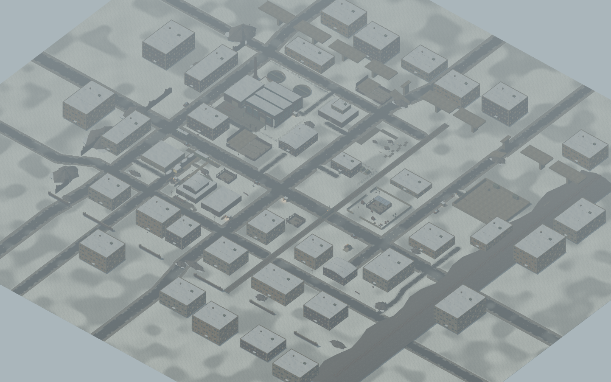
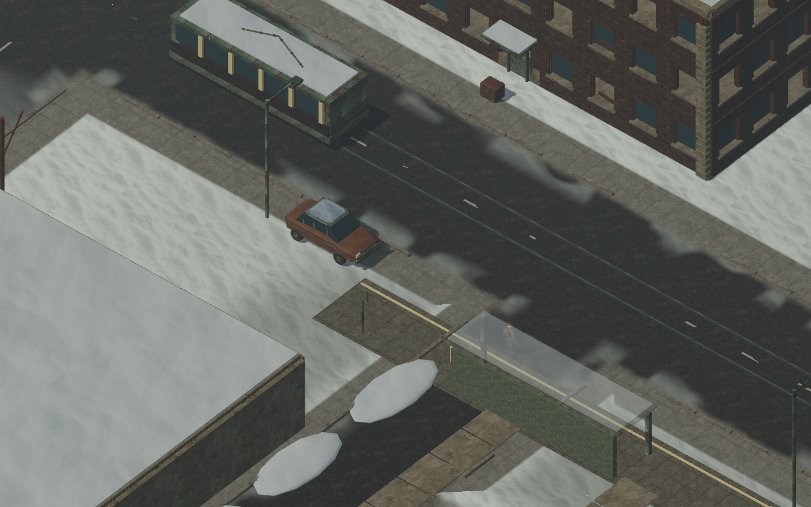
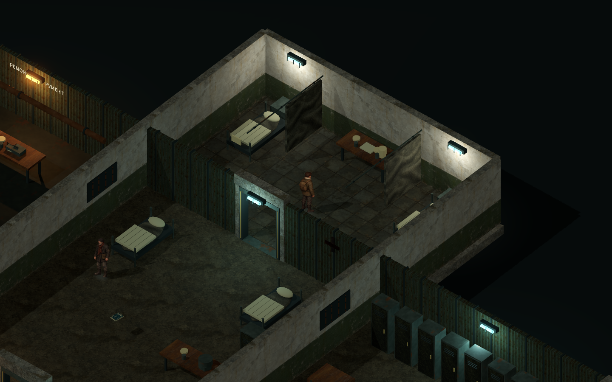

# 地铁1982 v36 · 街区与聚落重制候选版

[下载独立游戏包](https://github.com/2459654640-ship-it/godot/archive/46a1afac2abf617e981d39b72da988eac7b976b7.zip) · [源工程](https://github.com/2459654640-ship-it/godot/tree/metro-complete-rework) · [空间方案](design/urban-ecology.md) · [测试记录](validation)

完整解压后运行 `Metro1982.exe`。Linux 可运行 `Metro1982.x86_64`。保留同目录的 PCK 文件和整个 `content` 文件夹。更新安装目录时原存档可继续使用。

东郊旧货运路保留了战前电车线。电车站的民防留置室开放前后出入口，候车台、住宅供热院和水厂装卸院各有实际通路。断缆广场有真实地形高差和局部辐射，可以从西侧绕过。街区图标出了铁路、已发现设施和污染范围。

公社增加育苗、清洗分装和外勤清洁空间，谢契增加机车检修台和住户补缀间，D-6 增加与分诊相通的留观病房，灰狗避难所增加外勤储料与晾晒间。沿用 v35 的四类终局、父子重逢和可实际护送的安娜线。

[所有实景截图](screenshots)

Windows 包采用正式 Godot 模板。已做工程回归、Linux 原生启动及实景渲染检查；Windows 真机兼容性、性能和真人通关仍待验收。
