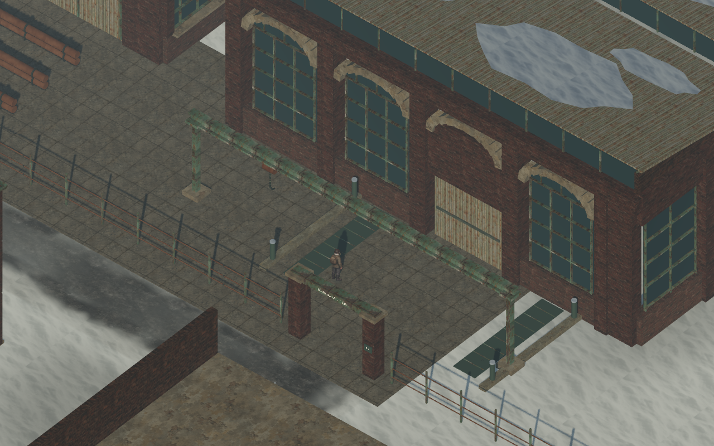
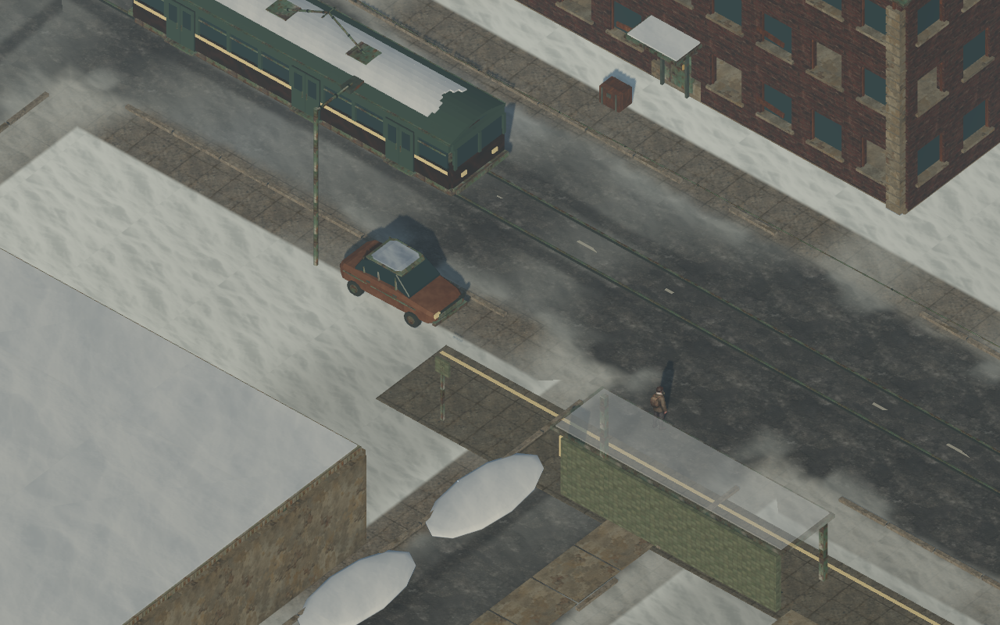
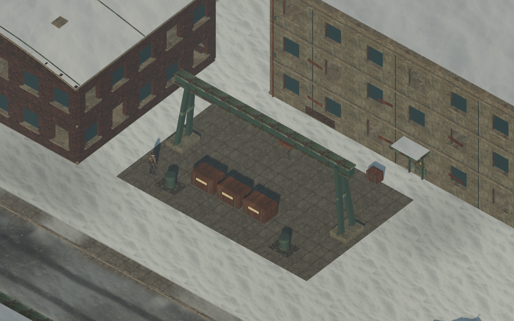

# 地铁1982 v37 · 地表重制候选版

[下载独立游戏包](https://github.com/2459654640-ship-it/godot/archive/c961dfd443d5843f2747952add0cc05d35b72672.zip) · [源工程](https://github.com/2459654640-ship-it/godot/tree/metro-complete-rework) · [全部游戏实景](screenshots) · [材质与空间调整](design/surface.md)

完整解压后运行 `Metro1982.exe`，并保留同目录的 PCK 与 `content` 文件夹。Linux 可运行 `Metro1982.x86_64`。

东郊水厂以砖砌泵厅、锯齿屋顶、锅炉房和阀塔构成一组建筑。货场的吊架、车辆装卸区和铁路路基各有独立空间。工人街通过坡顶砖楼、预制板楼和露出折断楼板的受损住宅建立不同的街景。旧电车用实际轨距、轮组、折叠门和弧顶重建。

新沥青和水厂砖材质、盐霜与轮迹、屋顶积雪和斜射的冬季阳光共同应用在游戏场景里。图片由 Godot 实际渲染。街道、厂门、货场等近景采用正常游戏镜头尺度，阀塔与全景使用美术检查镜头。

[上一版的剧情、聚落与实景资料](../v36)
