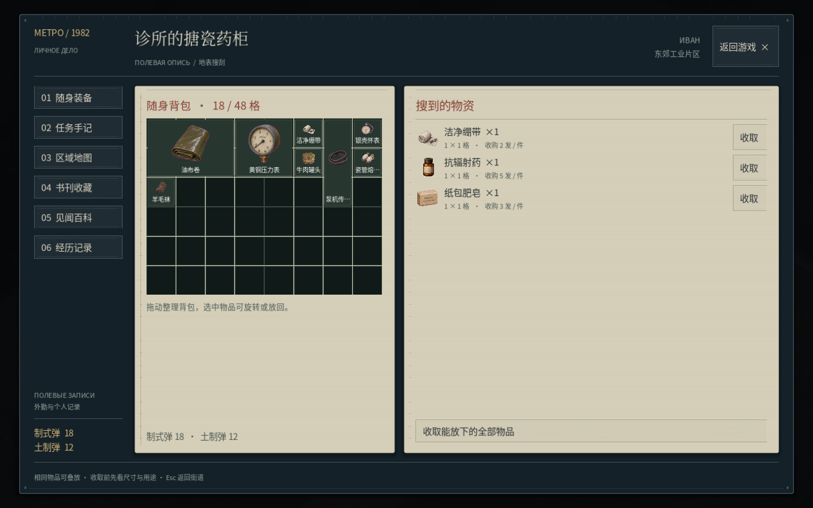

# 地铁1982 · v38 地表出勤

[下载 Windows / Linux 游戏包](https://github.com/2459654640-ship-it/godot/archive/9a4205149a7429230d7d56ee4fe2b347012f1319.zip) · [查看本版源工程](https://github.com/2459654640-ship-it/godot/tree/dd2986c573c1cf074dbf9aa86d9431a11aef74ee)

## 出勤路线

1. 在聚落整理装备与寄存物资，随后从出站口前往东郊。
2. 到诊所、民房、货场、泵站或灰狗避难所寻找物资。走到可搜索的容器前，边缘会亮起。按 E 搜索，移动、射击或受伤会中止搜索。
3. 东郊有 7 处新增兽群遭遇和 7 名持枪灰狗游荡者。可以绕过交战地点，或交火后搜取灰狗留下的武器、弹药和装备。
4. 按 M 打开地图，绿色箭头显示本次的撤离口。回到聚落后，可在寄存柜查看最近撤离清单。行动失败会丢失随身普通装备和物资，任务关键物品及已寄存物资保留。

出勤沿线现有 87 个搜索容器，其中 71 个在东郊。同一次出勤切换地图或读取存档会保留搜过的容器和巡逻部署。开始下一次出勤时，容器物资和游荡队伍重新布置。

## 物品格位

背包共有 48 格。搜刮时可以查看物品实际尺寸和聚落收购价，拖动已携带的物品，旋转长件，或把物品放回容器。尺寸较大的物品需要一片连续空位。

| 示例 | 占格 | 收购价 |
| --- | --- | --- |
| 银壳怀表 | 1×1 | 22 发制式弹 |
| 压制茶砖 | 2×1 | 6 发制式弹 |
| 黄铜压力表 | 2×2 | 14 发制式弹 |
| 泵机传动带 | 3×1 | 7 发制式弹 |
| 油布卷 | 3×2 | 4 发制式弹 |

[靠近容器](screenshots/container-outline.png) · [搜索进度](screenshots/live-search.png) · [灰狗巡逻](screenshots/greyhound-road-patrol.png) · [撤离地图](screenshots/extraction-map.png) · [撤离清单](screenshots/extraction-report.png)

## 验证

Godot 4.6.3 通过出勤、战役、存档、界面和旧泵站回归检查。Linux 原生包已启动，导出的资源包已实际加载东郊。截图取自 Linux Vulkan 软件渲染。Windows 真机性能和长时间游玩尚待验收。[验证记录](validation)
