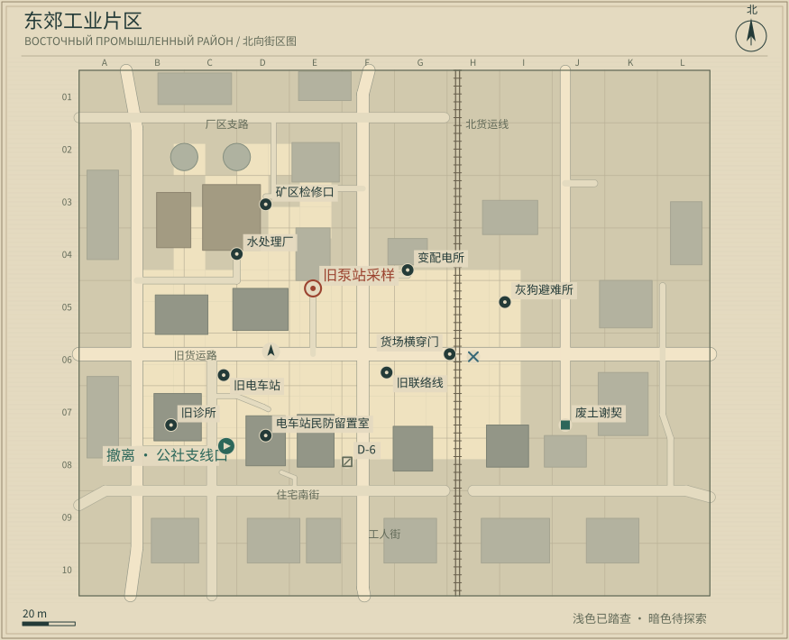

# 地铁1982 · v39 聚落联络与区域地图

[下载游戏包](https://github.com/2459654640-ship-it/godot/archive/5b55c8ce0795bd8ed79aa17faa7f5c688c1ec91f.zip) · [源工程](https://github.com/2459654640-ship-it/godot/tree/127a9f2f536798ab596ccb8bbe7d5d5cd3dff0cd)

## 从听闻到入站

伊万起初熟悉 D-6。擅离路线会先从谢尔盖那里听到谢契。向他追问隧道里的红箭头，也可以在开局得知公社。完成水厂任务的伊万会听老兵谈到公社。其余消息可以通过聚落联络人、地表轮值牌和任务沿线的登记册获得。

1. **打听消息。** 先知道聚落名称和可调查的方向，地图上的入口要等线索核实后才出现。
2. **确认入口。** 旧电车站的乘客名簿、运件登记和联络口上的标记都能指认路线。
3. **取得担保。** 在本方取得信任后，向亚历山德拉、彼得或科瓦廖夫提出访问，值守核对首次登记。公社与谢契可以这样往返，D-6 有资格的外勤可接触谢契。D-6 与公社保留敌对门禁，矿区仍有自己的接应安排。

访问身份与阵营归属分别保存。原有主线与交付人不因入站而改换。

## 查阅地图

按 M 打开区域地图。东郊街图对应游戏内道路、铁路、厂区和联络口，浅色标示已踏查范围。点选地标可查门禁或将它设成目的地，路线栏可快速定位当前任务、撤离口和自己。聚落联络栏收录伊万已知的消息。进入站内后可查阅房间和门口，未造访的站内图纸保持隐藏。

## 主线范围

公社、谢契、D-6 三条主线分别走过各自的外勤，再进入星城的技术联络、家庭线和预警与撤离。四类收尾都需要执行现场方案，单选方案不会结束旅程。回归测试覆盖三条路线分别通往四类终局的状态条件和过场。这些检查使用了可复现的战役进度存档。完整路线的节奏和交互手感仍需以连续试玩来核对。[验证记录](validation)
